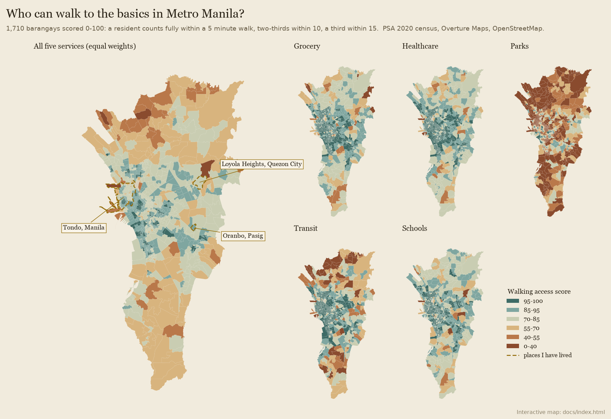
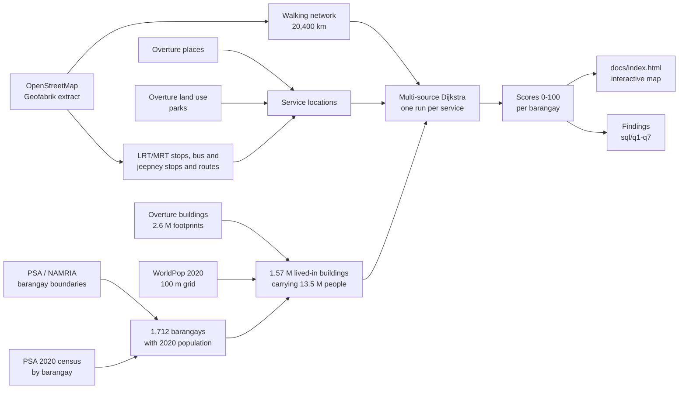

# Who can walk to the basics? Walking access in Metro Manila

Earl Yu.
Open data only.
Run on 29 October 2026 against Overture Maps release 2026-10-21.0 and an OpenStreetMap snapshot from 28 October 2026.

**The so-what.**
In Metro Manila the five-minute grocery is not the main divide.
61% of the region's 13.5 million people live within a five minute walk of a grocery, convenience store or market, and 91% within ten.
The gaps are elsewhere.
Only 15% of people live within five minutes of a park, and the most crowded barangays have the least green space.
Only 6.5% live within a ten minute walk of an LRT or MRT stop, while 44% are more than 5 km from one.
And access falls away at the edges: the average resident of Valenzuela scores 55 out of 100 against 87 in Makati.
Inside the old core the worst places are not the crowded ones in general but specific port-side communities in Tondo, where I grew up.



*Map 1. Walking access score by barangay: all five services together (left) and each service on its own (right).
The interactive version is [`docs/index.html`](docs/index.html): download it and open it in any browser, or serve `docs/` with GitHub Pages.
Hover over (or tap) any barangay to see its population, its score for each service, the share of residents within a five minute walk, and the typical walk to the nearest one.*

## Contents

1. [Why this, and why Metro Manila](#1-why-this-and-why-metro-manila)
2. [Questions](#2-questions)
3. [Findings](#3-findings)
4. [Places I have lived](#4-places-i-have-lived)
5. [Method](#5-method)
6. [Data sources](#6-data-sources)
7. [Limitations](#7-limitations)
8. [The SQL behind each answer](#8-the-sql-behind-each-answer)
9. [How to reproduce](#how-to-reproduce)

## 1. Why this, and why Metro Manila

This project follows the "Urban Accessibility" template from a spatial analytics course: which neighbourhoods in a city have the best and worst walking access to essential services, and whose neighbourhood has a five minute walk to a grocery store and whose does not.
The template is written for a US city with census tracts.
I ran it on Metro Manila because it is home: I was born and raised in Tondo, spent two years of college in Loyola Heights near Ateneo de Manila, and now live in Oranbo, Pasig.

Metro Manila (the National Capital Region) is 17 cities and one municipality, 13.5 million people at the 2020 census, on about 600 km&sup2;.
Its neighbourhood unit is the barangay, the smallest unit of local government.
There are 1,710 of them, and they vary enormously: a barangay in Manila's old districts can be one city block of a few hundred people, while Barangay 176 in Caloocan held 261,729 people in 2020.

## 2. Questions

1. **Q1.** Which barangays have the best and worst walking access to groceries, healthcare, parks, transit and schools?
2. **Q2.** How do the 17 cities compare?
3. **Q3.** Is access organised around the rail lines?
4. **Q4.** Equity: do crowded barangays get more or less?
5. **Q5.** How do the three places I have lived compare?
6. **Q6.** How complete are the service layers?
7. **Q7.** Do the main modelling choices drive the result?

The score is built so that it can be read in plain terms.
For each service, a resident counts fully if the nearest one is within a five minute walk (375 m at 4.5 km/h), two-thirds within ten minutes (750 m), a third within fifteen (1,125 m), and not at all beyond that.
A barangay's service score is the average over its residents, so it is also the average of the shares of residents within 5, 10 and 15 minutes.
The composite gives the five services equal weight.

## 3. Findings

Metro-wide, the average resident scores **73 out of 100**.
By service: groceries 83, healthcare 85, schools 85, transit 72, parks 41.

| Service | Within 5 min | Within 10 min | Within 15 min |
|---|---:|---:|---:|
| Grocery, convenience store or market | 61% | 91% | 97% |
| Healthcare (hospital, clinic, health centre, pharmacy) | 65% | 91% | 97% |
| School | 64% | 93% | 98% |
| Transit (rail stop, bus or jeepney stop, jeepney route) | 51% | 76% | 88% |
| Park | 15% | 42% | 66% |
| *Public market (palengke), not scored* | *14%* | *44%* | *67%* |
| *LRT/MRT stop, not scored* | *1.5%* | *6.5%* | *13%* |

Share of Metro Manila residents by walk to the nearest one.
Source: [`data/derived/headline.json`](data/derived/headline.json).

### 3.1 Best and worst served barangays (Q1)

Among the 297 barangays of at least 10,000 people:

| Rank | Barangay | City | People | Score | Grocery | Health | Parks | Transit | Schools |
|---:|---|---|---:|---:|---:|---:|---:|---:|---:|
| 1 | Poblacion | Makati | 16,706 | **97.3** | 100 | 100 | 94 | 97 | 96 |
| 2 | Comembo | Makati | 15,805 | 95.4 | 96 | 99 | 85 | 97 | 100 |
| 3 | Santo Tomas | Pasig | 12,904 | 95.3 | 100 | 100 | 83 | 100 | 94 |
| 4 | Calumpang | Marikina | 15,602 | 94.9 | 96 | 91 | 92 | 99 | 97 |
| 5 | Post Proper Northside | Makati | 57,940 | 94.5 | 97 | 92 | 93 | 98 | 92 |
| ... | | | | | | | | | |
| 293 | Coloong | Valenzuela | 12,550 | 41.7 | 64 | 73 | 7 | 6 | 58 |
| 294 | Balangkas | Valenzuela | 14,318 | 41.2 | 38 | 80 | 34 | 0 | 53 |
| 295 | Pansol | Quezon City | 35,254 | 39.5 | 40 | 48 | 47 | 23 | 39 |
| 296 | Lawang Bato | Valenzuela | 23,786 | 34.1 | 42 | 52 | 5 | 15 | 56 |
| 297 | Barangay 128 (Tondo) | Manila | 23,702 | **26.9** | 40 | 29 | 20 | 25 | 20 |

Top and bottom ten in [`data/derived/q1_best_worst.csv`](data/derived/q1_best_worst.csv); every barangay in [`data/derived/barangay_scores.csv`](data/derived/barangay_scores.csv).
("Katipunan", 7th, is a small barangay in western Quezon City, not the Katipunan Avenue strip near Ateneo.
Comembo and West Rembo are two of the ten EMBO barangays now governed by Taguig; the boundary file still places them in Makati.)

The best-served barangays are compact, mixed-use and walkable: Makati's Poblacion and the Rembo barangays, old town centres like Santo Tomas (Pasig) and Calumpang (Marikina), and the university belt of Sampaloc.
Across all sizes, 174 barangays score 95 or more, but they are mostly small and hold 308,000 people between them.

The worst-served fall into three groups.
**The northern edge**: six of the bottom ten are in Valenzuela, where industrial estates, rivers and fishponds leave long walks to everything and few jeepney routes are mapped.
**Low-density enclaves**: Pansol in Quezon City, next door to Loyola Heights, is spread thin over 3.4 km&sup2;, and its typical resident walks almost 900 m to a grocery and 1.3 km to transit.
Poor walking access here is about the shape of the place, not poverty.
**Port-side Tondo**: Barangay 20, home to the Parola Compound, and Barangay 128, home to Smokey Mountain, are dense communities cut off by the port and by their own street pattern.
Barangay 128's last place needs a caveat: WorldPop puts 70% of its people on the Manila Harbour Centre reclamation rather than in the housing blocks east of Mel Lopez Boulevard, and if they in fact live in those blocks its score would be about 67 ([section 7](#7-limitations)).

### 3.2 Cities (Q2)

| City | People | Score | Grocery | Health | Parks | Transit | Schools | Grocery within 5 min | Park within 5 min |
|---|---:|---:|---:|---:|---:|---:|---:|---:|---:|
| Makati | 629,616 | **86.7** | 95 | 92 | 65 | 91 | 92 | 86% | 33% |
| San Juan | 126,347 | 85.2 | 95 | 95 | 48 | 96 | 92 | 84% | 16% |
| Pateros | 65,227 | 83.4 | 89 | 90 | 58 | 85 | 94 | 69% | 11% |
| Pasay | 440,656 | 82.9 | 94 | 94 | 45 | 93 | 90 | 82% | 15% |
| Manila | 1,846,513 | 81.7 | 91 | 91 | 45 | 91 | 91 | 79% | 16% |
| Mandaluyong | 425,758 | 80.7 | 94 | 95 | 38 | 86 | 91 | 83% | 8% |
| Pasig | 803,159 | 77.3 | 87 | 88 | 51 | 74 | 86 | 66% | 22% |
| Malabon | 380,522 | 76.1 | 84 | 89 | 37 | 83 | 88 | 59% | 12% |
| Taguig | 886,722 | 73.7 | 85 | 86 | 37 | 76 | 85 | 65% | 11% |
| Navotas | 247,543 | 73.3 | 85 | 89 | 21 | 80 | 91 | 62% | 6% |
| Quezon City | 2,960,048 | 72.8 | 79 | 83 | 47 | 72 | 83 | 54% | 17% |
| Marikina | 456,059 | 72.7 | 77 | 80 | 56 | 69 | 82 | 52% | 26% |
| Las Piñas | 606,293 | 66.7 | 75 | 79 | 36 | 65 | 79 | 44% | 14% |
| Caloocan | 1,661,584 | 66.5 | 83 | 84 | 27 | 53 | 86 | 58% | 8% |
| Parañaque | 689,992 | 65.3 | 77 | 75 | 38 | 60 | 77 | 49% | 17% |
| Muntinlupa | 543,445 | 61.9 | 68 | 68 | 46 | 60 | 67 | 40% | 19% |
| Valenzuela | 714,978 | **54.9** | 72 | 76 | 14 | 37 | 77 | 40% | 5% |

Resident-weighted: a city's score is its average resident's score.
Source: [`data/derived/q2_cities.csv`](data/derived/q2_cities.csv).

The pattern is core against edge.
The old centre (Manila, San Juan, Pasay, Mandaluyong) and the business districts (Makati) score above 80.
The newer, lower-density cities on the northern and southern edges (Valenzuela, Caloocan's northern half, Las Piñas, Parañaque, Muntinlupa) score in the 50s and 60s.
Quezon City, the biggest, sits in between, because it contains both.

### 3.3 Rail lines (Q3)

| Walk to the nearest LRT/MRT stop | People | Share | Score | Grocery | Health | Parks | Transit | Schools |
|---|---:|---:|---:|---:|---:|---:|---:|---:|
| Within 10 min (750 m) | 878,521 | 6.5% | **87.1** | 96 | 96 | 52 | 97 | 94 |
| 10-20 min (750 m-1.5 km) | 1,621,110 | 12.0% | 82.4 | 93 | 94 | 42 | 91 | 92 |
| 20-40 min (1.5-3 km) | 2,898,947 | 21.5% | 80.1 | 90 | 90 | 45 | 86 | 90 |
| 40-67 min (3-5 km) | 2,159,297 | 16.0% | 73.2 | 81 | 82 | 46 | 73 | 83 |
| Over 67 min (5 km+) | 5,926,586 | 44.0% | **64.8** | 75 | 78 | 35 | 55 | 80 |

Source: [`data/derived/q3_rail.csv`](data/derived/q3_rail.csv).

Everything else is better near the rail lines.
People within ten minutes of LRT-1, LRT-2 or MRT-3 score 87; people more than 5 km away score 65, with the steepest drop in transit itself (97 to 55).
The rail lines run through the old core and along EDSA, where shops, clinics and schools cluster anyway, so this is a gradient of urban form as much as of rail.
But it also shows how few people the rail network reaches on foot: under one in five residents is within a 20 minute walk of a station.
The other 80% rely on jeepneys and buses, which is why the jeepney route network matters so much in [section 5.3](#53-services).

### 3.4 Equity: density (Q4)

Barangays sorted by population density and cut into ten groups of about 1.35 million people each.

| Density decile | People per km&sup2; | Score | Grocery within 5 min | Palengke within 10 min | Health within 5 min | Park within 5 min | Transit within 5 min | Mean walk to a park |
|---:|---|---:|---:|---:|---:|---:|---:|---:|
| 1 (least dense) | 100-12,400 | 65.2 | 43% | 25% | 47% | **21%** | 42% | 1,049 m |
| 2 | 12,500-17,600 | 67.0 | 49% | 25% | 50% | 16% | 41% | 1,036 m |
| 3 | 17,700-21,100 | 69.5 | 52% | 28% | 56% | 20% | 41% | 858 m |
| 4 | 21,100-24,100 | 67.7 | 52% | 34% | 53% | 14% | 38% | 1,001 m |
| 5 | 24,100-28,000 | 74.0 | 62% | 38% | 61% | 21% | 48% | 829 m |
| 6 | 28,000-34,600 | 70.2 | 57% | 41% | 63% | 11% | 45% | 1,062 m |
| 7 | 34,700-48,200 | 78.1 | 68% | 54% | 78% | 13% | 64% | 959 m |
| 8 | 48,200-59,700 | 74.7 | 69% | 52% | 69% | 11% | 56% | 1,009 m |
| 9 | 59,700-86,100 | 80.3 | 78% | 66% | 80% | 13% | 65% | 929 m |
| 10 (most dense) | 86,200-487,800 | **82.7** | 82% | 71% | 87% | **13%** | 74% | 931 m |

Source: [`data/derived/q4_density.csv`](data/derived/q4_density.csv).

On the template's equity question the answer runs the opposite way to a typical US city.
In Metro Manila the most crowded barangays have the best walking access to shops, clinics, schools and jeepneys: 82% of people in the densest tenth have a grocery within five minutes, against 43% in the least dense tenth, and 71% have a palengke within ten minutes against 25%.
Density pays for itself in footfall.
The one service that runs the other way is green space.
The densest barangays have the smallest share within five minutes of a park (13% against 21%), and the densest half of residents all sit at 13% or below.
Crowding buys you a sari-sari economy and a jeepney at the corner, and costs you somewhere to breathe.

## 4. Places I have lived

| Place | Barangays | People (2020) | Score | Percentile | Grocery | Health | Parks | Transit | Schools | Grocery within 5 min | Palengke within 10 min | Park within 5 min | LRT/MRT within 15 min |
|---|---:|---:|---:|---:|---:|---:|---:|---:|---:|---:|---:|---:|---:|
| Tondo, Manila (birth to 18) | 259 | 654,220 | 78.5 | 66th | 89 | 90 | **34** | 91 | 88 | 76% | 63% | **9%** | 22% |
| Loyola Heights, Quezon City (college) | 1 | 21,140 | 76.2 | 57th | 69 | 85 | 74 | 67 | 86 | **33%** | 58% | 37% | 32% |
| Oranbo, Pasig (now) | 1 | 3,267 | **91.9** | 94th | 96 | 86 | 89 | 94 | 94 | 87% | **0%** | 68% | **0%** |

Percentile: the share of Metro Manila residents whose barangay scores lower.
Tondo figures are resident-weighted across the whole district.
Source: [`data/derived/q5_places_lived.csv`](data/derived/q5_places_lived.csv).

**Tondo** is drawn as the whole Tondo district (Tondo I/II, 259 barangays).
My zip code was 1013, Tondo North, but PhilPost assigns zip codes by district and publishes no barangay list for them, so the 1013 half cannot be drawn honestly.
Tondo as a whole is better served than most of Metro Manila: the average resident has a grocery, a clinic, a school and a jeepney within a few minutes, and a palengke within ten.
What it lacks is parks: only 9% of Tondo's 654,000 people live within five minutes of one.
It also holds the widest spread of any place on the map, from 27 barangays scoring 95 or more to the two port-side barangays near the bottom of Q1.

**Loyola Heights** surprised me.
It is the college town of Katipunan Avenue around Ateneo, yet it scores below Tondo.
The Katipunan strip is well served, but much of the barangay is campus or quiet residential village, and the typical resident walks about 500 m to a grocery.
Only a third of its people have one within five minutes.

**Oranbo** scores in the top 6% of Metro Manila.
It is small (3,267 people in 2020) and sits around Capitol Commons and Estancia, so the supermarket, pharmacy and clinics are close by in the mall, and two-thirds of residents have a park within five minutes.
But two things that Tondo has, it lacks: no one in Oranbo lives within ten minutes of a palengke, or within fifteen minutes of an LRT or MRT stop.
It is convenience built around a mall rather than a street.

## 5. Method

### 5.1 Pipeline



| Step | Script | SQL | Writes |
|---|---|---|---|
| Download boundaries, census, WorldPop, OSM | [`src/fetch_data.sh`](src/fetch_data.sh) | | `data/raw/` (gitignored) |
| Read Overture from S3 and OSM from the extract | [`src/extract.py`](src/extract.py) | [`extract_overture_*.sql`](sql/), [`extract_osm.sql`](sql/extract_osm.sql), [`walk_network.sql`](sql/walk_network.sql), [`osm_services.sql`](sql/osm_services.sql) | `data/work/` (gitignored) |
| Join barangays to the census | [`src/barangays.py`](src/barangays.py) | | `data/work/barangays.parquet` |
| Place people in buildings | [`src/population.py`](src/population.py) | [`place_people.sql`](sql/place_people.sql) | `data/work/origins.parquet` |
| Walking distances | [`src/network.py`](src/network.py) | | `data/work/origin_dist.parquet` |
| Scores and answers | [`src/score.py`](src/score.py) | [`resident_scores.sql`](sql/resident_scores.sql), [`barangay_scores.sql`](sql/barangay_scores.sql), [`q1`-`q7`](sql/) | [`data/derived/`](data/derived/) |
| Interactive map | [`src/webmap.py`](src/webmap.py) | | [`docs/index.html`](docs/index.html) |
| Static preview | [`src/mapfig.py`](src/mapfig.py) | | [`figures/preview_map.png`](figures/preview_map.png) |

Shared paths and constants (Overture release, study box, thresholds, the places lived) are in [`src/common.py`](src/common.py).
DuckDB does the heavy lifting in SQL: it reads Overture's GeoParquet straight from the public S3 bucket, reads the OpenStreetMap `.pbf` with `ST_ReadOSM`, and does the spatial joins and aggregation.
Python handles the three things SQL is awkward at: reading the WorldPop raster, shortest paths on the network, and drawing.

### 5.2 Where people live

Accessibility is about people, not land, so every score is an average over residents.
The census gives each barangay's population but not where in the barangay people live, and Manila's barangays are small: half of Metro Manila's barangays are under 4 hectares, the size of four cells of a 100 m population grid.
So people are placed in three layers, coarse to fine ([`place_people.sql`](sql/place_people.sql)):

1. **PSA 2020 census** fixes the total for each barangay.
2. **WorldPop 2020 (100 m, constrained)** says which parts of the barangay are lived in.
3. **Overture building footprints** place people within each 100 m cell, in proportion to footprint area.

Buildings tagged as clearly non-residential (commercial, school, church, factory and so on) get no one; untagged buildings, 81% of them, stay in.
The result is 1.57 million lived-in buildings carrying exactly the census total of 13,484,462 people, and every one of the 1,710 populated barangays has at least one.

### 5.3 Services

| Service | What counts | Source | Locations used | Coverage check |
|---|---|---|---:|---|
| Grocery | Supermarkets, grocery and convenience stores, produce, meat and fish shops, public markets | Overture places, plus OSM `amenity=marketplace` | 7,112 Overture + 467 OSM markets | 60% of 7,138 OSM grocery shops have an Overture match within 100 m |
| *Palengke flag* | Public and wet markets (not scored, shown in the popup) | Overture `farmers_market` and market names, plus OSM `amenity=marketplace` | 232 Overture + 467 OSM | Overture alone is thin, hence the OSM top-up |
| Healthcare | Hospitals, clinics, health centres, general practice, maternity and paediatric clinics, pharmacies (not dentists or specialists) | Overture places | 9,461 | 80% of 5,025 OSM health features matched |
| Schools | Elementary, middle and high schools, public and private (not preschools, colleges or tutoring) | Overture places | 6,895 | 75% of 2,460 OSM schools matched |
| Parks | Parks, village greens and recreation grounds of at least 0.1 ha; walking distance is to the nearest point on the edge | Overture base `land_use` (assembled from OSM) | 993 polygons, 923 ha | OSM has 1,156 `leisure=park` features of any size |
| Transit | LRT-1, LRT-2 and MRT-3 stops; mapped bus and jeepney stops; bus terminals; any point on a jeepney route | OSM route relations and stops, plus Overture `bus_station` | 51 stations, 4,686 stops, 323 terminals, 314 jeepney routes | Jeepney routes come from a mapped LTFRB route set and may be out of date |

Overture places below a confidence of 0.5 (27% of the candidate service places, mostly stale or duplicate listings) and places marked closed are dropped.
Services up to about 1.5 km outside Metro Manila (the study box runs from 120.85 to 121.20 E and 14.30 to 14.82 N) count too, so a resident near a city border is not penalised for the border.

Three choices shape the transit layer:

- **Jeepney routes are stops.** Jeepneys pick up and drop off anywhere along their route ("para po"), so every point on a road a jeepney route runs on counts as a place to board.
- **PNR is out.** The PNR Metro Manila commuter line has been suspended since March 2024 for North-South Commuter Railway works, and the Metro Manila Subway is not open yet, even though OpenStreetMap still maps both.
- **Rail is also shown on its own.** The popup gives the walk to the nearest LRT/MRT stop separately, because a jeepney and a train are not the same thing.

### 5.4 Walking distance

Distances run along the OpenStreetMap walking network: every way a person may walk on, using the same filter as OSMnx's `walk` network type ([`walk_network.sql`](sql/walk_network.sql)).
Expressways, cycleways, private roads and anything under construction are out; trunk roads with footpaths, alleys, footpaths and stairs are in; every way is walkable in both directions.
That is 810,070 segments and about 20,400 km of walkable ways after keeping the largest connected piece (97.7% of nodes).

For each service, one multi-source Dijkstra run ([`src/network.py`](src/network.py)) finds the network distance from every network node to the nearest location of that service.
Buildings and services join the network at their nearest node, and the straight-line hop to it is added (median 23 m for buildings).
Distance converts to time at 4.5 km/h: 5 minutes is 375 m, 10 is 750 m, 15 is 1,125 m.

### 5.5 Choropleth and map

The map ([`docs/index.html`](docs/index.html)) is one self-contained page: Leaflet from a CDN and the barangay scores inlined as GeoJSON, simplified to about 8 m with shared edges kept.
The colour classes (0-40, 40-55, 55-70, 70-85, 85-95, 95-100) are the same for every service, so switching service shows real differences, not a rescaled ramp.
On the same downloaded data a re-run writes byte-identical tables, map and figure.

## 6. Data sources

All are public and free; none needs an account or key.

| Layer | Source | Link | Licence | Granularity | Vintage |
|---|---|---|---|---|---|
| Barangay boundaries | PSA and NAMRIA, Common Operational Dataset (COD-AB), via HDX | [HDX `cod-ab-phl`](https://data.humdata.org/dataset/cod-ab-phl) | CC BY-IGO | 1,712 polygons in NCR (admin level 4) | Version v03, valid from 13 February 2025 |
| Barangay population | PSA 2020 Census of Population and Housing, via OCHA Philippines on HDX | [HDX](https://data.humdata.org/dataset/2020-census-total-population-by-barangay_admin4) | CC BY 4.0 | 1,710 barangays in NCR | Census day 1 May 2020 |
| Gridded population | WorldPop Global2, constrained, release R2025A | [WorldPop / HDX](https://data.humdata.org/dataset/worldpop-population-counts-2015-2030-phl) | CC BY 4.0 | 100 m | 2020 |
| Buildings | Overture Maps `buildings` theme | [overturemaps.org](https://docs.overturemaps.org/) | ODbL 1.0 | 2.6 million footprints in the study box | Release 2026-10-21.0 |
| Places | Overture Maps `places` theme | [overturemaps.org](https://docs.overturemaps.org/) | CDLA Permissive 2.0 | 455,000 places in the study box | Release 2026-10-21.0 |
| Parks | Overture Maps `base` theme, `land_use` | [overturemaps.org](https://docs.overturemaps.org/) | ODbL 1.0 | Polygons | Release 2026-10-21.0 |
| Walking network, transit, markets | OpenStreetMap, Geofabrik Philippines extract | [download.geofabrik.de](https://download.geofabrik.de/asia/philippines.html) | ODbL 1.0 | Ways, nodes, route relations | Snapshot 28 October 2026 |

Data: © OpenStreetMap contributors (ODbL); Overture Maps Foundation; PSA and NAMRIA via the Humanitarian Data Exchange; WorldPop, University of Southampton.
The derived tables in `data/derived/` and the map contain information from OpenStreetMap and Overture and are shared under the same terms.

## 7. Limitations

- **Mapped is not the same as there.** A service that is not in Overture or OpenStreetMap does not count. The biggest gap is the sari-sari store: Metro Manila has tens of thousands, almost none of them mapped, so the grocery score measures access to mapped groceries, convenience stores and markets, not to the corner store. Gaps are likely worst in informal settlements, which are also where access is lowest, so their scores may be understated.
- **Barangay 128's rank is uncertain.** Its polygon includes the Manila Harbour Centre reclamation, and WorldPop places 70% of its people there. If they actually live in the Smokey Mountain blocks east of Mel Lopez Boulevard, the barangay would score about 67 rather than 27. Other port and waterfront barangays carry the same risk on a smaller scale.
- **The jeepney layer is an assumption and may be dated.** Treating every point on a jeepney route as a stop is how jeepneys work in practice, but loading bans on some major roads break it, and the mapped LTFRB routes predate the ongoing jeepney modernisation and route rationalisation. Dropping the jeepney routes lowers the metro score from 73.0 to 71.4 but leaves the barangay ranking almost unchanged (Q7, rank correlation 0.989).
- **The Overture confidence cut-off is a judgement.** Keeping every Overture record, whatever its confidence, raises the metro score to 75.2; the ranking barely moves (rank correlation 0.986).
- **Walkable is not the same as pleasant or safe.** The network counts a trunk road with a broken footpath, a flooded alley or a gated subdivision road as walkable. It does not see heat, floods, crossings, footbridges or security guards.
- **Population is 2020.** The census is the latest with barangay counts, and the buildings and services are from 2026. Fast-growing areas such as Taguig's newer districts are undercounted. The boundaries also predate the 2023 transfer of the EMBO barangays from Makati to Taguig, so those barangays are reported under Makati.
- **The nearest one, not the right one.** A pharmacy is not a hospital and a private school is not a free one. The score measures how far the nearest service is, not its quality, capacity or price.
- **Modifiable areal unit problem.** Scores are averages over barangays of very different sizes; a single block in Sampaloc and a 27 km&sup2; barangay in Quezon City are one row each. Resident-weighted averages (Q2-Q5) are the fairer comparison.

## 8. The SQL behind each answer

Each question is one SQL file in [`sql/`](sql/), run by [`src/score.py`](src/score.py) against two shared views: `residents` (one row per lived-in building with its distances and scores) and `barangay_scores`.
`${T5}`, `${T10}` and `${T15}` are 375, 750 and 1,125 m, and `${WORK}` is `data/work`; [`src/common.py`](src/common.py) fills them in.

<details>
<summary>The scoring views: <code>sql/resident_scores.sql</code> and <code>sql/barangay_scores.sql</code></summary>

```sql
-- One row per lived-in building: its people, its walking distances, and its scores.
-- A service scores 100 within a 5 minute walk (375 m), 67 within 10 (750 m),
-- 33 within 15 (1,125 m) and 0 beyond. This is the mean of the three "within"
-- flags, so a barangay's score is also the mean of its 5, 10 and 15 minute shares.
-- The composite gives the five services equal weight.
CREATE OR REPLACE VIEW residents AS
WITH d AS (
  SELECT * FROM read_parquet('${WORK}/origin_dist.parquet')
), s AS (
  SELECT *,
    100 * ((d_grocery <= ${T5})::INT + (d_grocery <= ${T10})::INT + (d_grocery <= ${T15})::INT) / 3 AS s_grocery,
    100 * ((d_health  <= ${T5})::INT + (d_health  <= ${T10})::INT + (d_health  <= ${T15})::INT) / 3 AS s_health,
    100 * ((d_parks   <= ${T5})::INT + (d_parks   <= ${T10})::INT + (d_parks   <= ${T15})::INT) / 3 AS s_parks,
    100 * ((d_transit <= ${T5})::INT + (d_transit <= ${T10})::INT + (d_transit <= ${T15})::INT) / 3 AS s_transit,
    100 * ((d_schools <= ${T5})::INT + (d_schools <= ${T10})::INT + (d_schools <= ${T15})::INT) / 3 AS s_schools
  FROM d
)
SELECT *, (s_grocery + s_health + s_parks + s_transit + s_schools) / 5 AS s_composite
FROM s;
```

```sql
-- Barangay scores: population-weighted means of the resident scores, the share of
-- residents within a 5 and 10 minute walk, and the median resident's distance,
-- for every service plus the palengke and rail extras.
CREATE OR REPLACE TABLE barangay_scores AS
WITH long AS (
  UNPIVOT (SELECT pcode, pop, d_grocery AS grocery, d_health AS health, d_parks AS parks,
                  d_transit AS transit, d_schools AS schools, d_palengke AS palengke, d_rail AS rail
           FROM residents)
  ON grocery, health, parks, transit, schools, palengke, rail
  INTO NAME service VALUE dist_m
), ranked AS (
  SELECT *,
         sum(pop) OVER (PARTITION BY pcode, service ORDER BY dist_m
                        ROWS BETWEEN UNBOUNDED PRECEDING AND CURRENT ROW) AS cum_pop,
         sum(pop) OVER (PARTITION BY pcode, service) AS tot_pop
  FROM long
), by_service AS (
  SELECT pcode, service,
         sum(pop) FILTER (WHERE dist_m <= ${T5})  / any_value(tot_pop) AS share_5,
         sum(pop) FILTER (WHERE dist_m <= ${T10}) / any_value(tot_pop) AS share_10,
         sum(pop) FILTER (WHERE dist_m <= ${T15}) / any_value(tot_pop) AS share_15,
         min(dist_m) FILTER (WHERE cum_pop >= tot_pop / 2) AS median_m
  FROM ranked
  GROUP BY ALL
), wide AS (
  PIVOT by_service ON service IN ('grocery', 'health', 'parks', 'transit', 'schools', 'palengke', 'rail')
  USING coalesce(any_value(share_5), 0) AS share5, coalesce(any_value(share_10), 0) AS share10,
        coalesce(any_value(share_15), 0) AS share15, any_value(median_m) AS median_m
  GROUP BY pcode
), composite AS (
  SELECT pcode,
         sum(pop) AS pop_placed,
         sum(pop * s_composite) / sum(pop) AS composite,
         sum(pop * s_grocery) / sum(pop) AS score_grocery,
         sum(pop * s_health)  / sum(pop) AS score_health,
         sum(pop * s_parks)   / sum(pop) AS score_parks,
         sum(pop * s_transit) / sum(pop) AS score_transit,
         sum(pop * s_schools) / sum(pop) AS score_schools
  FROM residents
  GROUP BY pcode
)
SELECT b.pcode, b.barangay, b.city, b.district, b.pop2020, b.area_km2, b.density_km2, b.place_lived,
       c.* EXCLUDE (pcode), w.* EXCLUDE (pcode)
FROM barangays b
LEFT JOIN composite c USING (pcode)
LEFT JOIN wide w USING (pcode);
```
</details>

<details>
<summary>Q1. Best and worst served barangays (<code>sql/q1_best_worst.sql</code>)</summary>

```sql
-- Q1. Which barangays have the best and worst walking access?
-- Ranked on the composite score among barangays of at least 10,000 people, so a
-- one-block barangay of 300 people cannot top the list on a technicality.
SELECT rank() OVER (ORDER BY composite DESC) AS best_rank,
       rank() OVER (ORDER BY composite ASC)  AS worst_rank,
       barangay, city, district, pop2020,
       round(composite, 1) AS composite,
       round(score_grocery) AS grocery, round(score_health) AS health, round(score_parks) AS parks,
       round(score_transit) AS transit, round(score_schools) AS schools
FROM barangay_scores
WHERE pop2020 >= 10000
QUALIFY best_rank <= 10 OR worst_rank <= 10
ORDER BY composite DESC;
```
</details>

<details>
<summary>Q2. Cities (<code>sql/q2_cities.sql</code>)</summary>

```sql
-- Q2. How do the 17 cities compare? Resident-weighted, so a city's score is its
-- average resident's score, and the 5 minute shares count people, not barangays.
SELECT b.city,
       sum(r.pop)::BIGINT AS people,
       round(sum(r.pop * r.s_composite) / sum(r.pop), 1) AS composite,
       round(sum(r.pop * r.s_grocery) / sum(r.pop)) AS grocery,
       round(sum(r.pop * r.s_health)  / sum(r.pop)) AS health,
       round(sum(r.pop * r.s_parks)   / sum(r.pop)) AS parks,
       round(sum(r.pop * r.s_transit) / sum(r.pop)) AS transit,
       round(sum(r.pop * r.s_schools) / sum(r.pop)) AS schools,
       round(100 * sum(r.pop) FILTER (WHERE r.d_grocery <= ${T5}) / sum(r.pop)) AS pct_grocery_5min,
       round(100 * sum(r.pop) FILTER (WHERE r.d_parks <= ${T5}) / sum(r.pop)) AS pct_park_5min
FROM residents r JOIN barangays b USING (pcode)
GROUP BY b.city
ORDER BY composite DESC;
```
</details>

<details>
<summary>Q3. Rail lines (<code>sql/q3_rail.sql</code>)</summary>

```sql
-- Q3. Is access organised around the rail lines? Residents grouped by their walk
-- to the nearest LRT-1, LRT-2 or MRT-3 stop.
SELECT CASE WHEN d_rail <= 750  THEN '1. within 10 min (750 m)'
            WHEN d_rail <= 1500 THEN '2. 10-20 min (750 m-1.5 km)'
            WHEN d_rail <= 3000 THEN '3. 20-40 min (1.5-3 km)'
            WHEN d_rail <= 5000 THEN '4. 40-67 min (3-5 km)'
            ELSE '5. over 67 min (5 km+)' END AS walk_to_rail,
       sum(pop)::BIGINT AS people,
       round(100 * sum(pop) / sum(sum(pop)) OVER (), 1) AS pct_people,
       round(sum(pop * s_composite) / sum(pop), 1) AS composite,
       round(sum(pop * s_grocery) / sum(pop)) AS grocery,
       round(sum(pop * s_health)  / sum(pop)) AS health,
       round(sum(pop * s_parks)   / sum(pop)) AS parks,
       round(sum(pop * s_transit) / sum(pop)) AS transit,
       round(sum(pop * s_schools) / sum(pop)) AS schools
FROM residents
GROUP BY ALL
ORDER BY walk_to_rail;
```
</details>

<details>
<summary>Q4. Density deciles (<code>sql/q4_density.sql</code>)</summary>

```sql
-- Q4. Equity: do crowded barangays get less? Barangays are sorted by population
-- density and cut into ten groups of roughly equal population (about 1.35 million
-- people each), so every decile is a tenth of Metro Manila's residents.
WITH b AS (
  SELECT *, sum(pop2020) OVER (ORDER BY density_km2, pcode) / sum(pop2020) OVER () AS cum_share
  FROM barangays WHERE pop2020 > 0
), d AS (
  SELECT pcode, density_km2, least(10, ceil(cum_share * 10))::INT AS density_decile FROM b
)
SELECT d.density_decile,
       count(DISTINCT d.pcode) AS barangays,
       sum(r.pop)::BIGINT AS people,
       round(min(d.density_km2), -2)::BIGINT AS min_density_km2,
       round(max(d.density_km2), -2)::BIGINT AS max_density_km2,
       round(sum(r.pop * r.s_composite) / sum(r.pop), 1) AS composite,
       round(100 * sum(r.pop) FILTER (WHERE r.d_grocery  <= ${T5}) / sum(r.pop)) AS pct_grocery_5min,
       round(100 * sum(r.pop) FILTER (WHERE r.d_palengke <= ${T10}) / sum(r.pop)) AS pct_palengke_10min,
       round(100 * sum(r.pop) FILTER (WHERE r.d_health   <= ${T5}) / sum(r.pop)) AS pct_health_5min,
       round(100 * sum(r.pop) FILTER (WHERE r.d_parks    <= ${T5}) / sum(r.pop)) AS pct_park_5min,
       round(100 * sum(r.pop) FILTER (WHERE r.d_transit  <= ${T5}) / sum(r.pop)) AS pct_transit_5min,
       round(100 * sum(r.pop) FILTER (WHERE r.d_schools  <= ${T5}) / sum(r.pop)) AS pct_school_5min,
       round(sum(r.pop * r.d_parks) / sum(r.pop))::INT AS mean_walk_to_park_m
FROM residents r JOIN d USING (pcode)
GROUP BY d.density_decile
ORDER BY d.density_decile;
```
</details>

<details>
<summary>Q5. Places I have lived (<code>sql/q5_places_lived.sql</code>)</summary>

```sql
-- Q5. How do the three places I have lived compare? Tondo is the whole district
-- (259 barangays), so its figures are resident-weighted across all of them.
-- percentile = share of Metro Manila residents whose barangay scores lower.
WITH ranked AS (
  SELECT *, sum(pop2020) OVER (ORDER BY composite ROWS BETWEEN UNBOUNDED PRECEDING AND 1 PRECEDING)
              / sum(pop2020) OVER () AS below_share
  FROM barangay_scores WHERE pop2020 > 0
)
SELECT place_lived,
       count(*) AS barangays,
       sum(pop2020) AS people,
       round(sum(pop2020 * composite) / sum(pop2020), 1) AS composite,
       round(100 * sum(pop2020 * below_share) / sum(pop2020)) AS percentile,
       round(sum(pop2020 * score_grocery) / sum(pop2020)) AS grocery,
       round(sum(pop2020 * score_health)  / sum(pop2020)) AS health,
       round(sum(pop2020 * score_parks)   / sum(pop2020)) AS parks,
       round(sum(pop2020 * score_transit) / sum(pop2020)) AS transit,
       round(sum(pop2020 * score_schools) / sum(pop2020)) AS schools,
       round(100 * sum(pop2020 * grocery_share5) / sum(pop2020)) AS pct_grocery_5min,
       round(100 * sum(pop2020 * palengke_share10) / sum(pop2020)) AS pct_palengke_10min,
       round(100 * sum(pop2020 * parks_share5) / sum(pop2020)) AS pct_park_5min,
       round(100 * sum(pop2020 * rail_share15) / sum(pop2020)) AS pct_rail_15min,
       min(round(composite, 1)) AS worst_barangay_score,
       max(round(composite, 1)) AS best_barangay_score
FROM ranked
WHERE place_lived IS NOT NULL
GROUP BY place_lived
ORDER BY composite DESC;
```
</details>

<details>
<summary>Q6. Coverage of the service layers (<code>sql/q6_coverage.sql</code>)</summary>

```sql
-- Q6. How complete are the service layers? Overture is the main source for
-- groceries, healthcare and schools; OSM is the cross-check. "matched" is the share
-- of OSM features with an Overture place of the same service within 100 m.
WITH ov AS (
  SELECT service, lon, lat, confidence >= ${MIN_CONFIDENCE} AND coalesce(operating_status, 'open') = 'open' AS used
  FROM read_parquet('${WORK}/overture_places.parquet')
), osm AS (
  SELECT osm_id, service, lon, lat FROM read_parquet('${WORK}/osm_services.parquet') WHERE kind = 'crosscheck'
), matched AS (
  SELECT DISTINCT o.osm_id
  FROM osm o JOIN ov v
    ON v.used AND v.service = o.service
   AND v.lat BETWEEN o.lat - 0.001 AND o.lat + 0.001
   AND v.lon BETWEEN o.lon - 0.001 AND o.lon + 0.001
   AND ST_Distance_Sphere(ST_Point(o.lon, o.lat), ST_Point(v.lon, v.lat)) <= 100
)
SELECT s.service,
       (SELECT count(*) FROM ov WHERE ov.service = s.service) AS overture_all,
       (SELECT count(*) FROM ov WHERE ov.service = s.service AND used) AS overture_used,
       (SELECT count(*) FROM osm WHERE osm.service = s.service) AS osm_features,
       round(100 * (SELECT count(*) FROM osm JOIN matched USING (osm_id) WHERE osm.service = s.service)
             / nullif((SELECT count(*) FROM osm WHERE osm.service = s.service), 0)) AS pct_osm_matched
FROM (VALUES ('grocery'), ('health'), ('schools')) s(service)
ORDER BY s.service;
```
</details>

<details>
<summary>Q7. Sensitivity to the confidence cut-off and the jeepney rule (<code>sql/q7_sensitivity.sql</code>)</summary>

```sql
-- Q7. Do the headline choices drive the result? Two alternative composites:
--   allconf    groceries, healthcare and schools from every Overture record, whatever its confidence
--   nojeepney  transit counts only rail stops, mapped stops and terminals, not the jeepney routes
-- For each: the metro-wide composite, and how closely the barangay ranking agrees with
-- the main one (Spearman rank correlation across barangays).
WITH flags AS (
  SELECT pcode, pop,
         100 * ((d_grocery_allconf <= ${T5})::INT + (d_grocery_allconf <= ${T10})::INT + (d_grocery_allconf <= ${T15})::INT) / 3 AS s_grocery_allconf,
         100 * ((d_health_allconf  <= ${T5})::INT + (d_health_allconf  <= ${T10})::INT + (d_health_allconf  <= ${T15})::INT) / 3 AS s_health_allconf,
         100 * ((d_schools_allconf <= ${T5})::INT + (d_schools_allconf <= ${T10})::INT + (d_schools_allconf <= ${T15})::INT) / 3 AS s_schools_allconf,
         100 * ((d_transit_nojeepney <= ${T5})::INT + (d_transit_nojeepney <= ${T10})::INT + (d_transit_nojeepney <= ${T15})::INT) / 3 AS s_transit_nojeepney,
         s_grocery, s_health, s_parks, s_transit, s_schools, s_composite
  FROM residents
), alt AS (
  SELECT pcode, pop,
         s_composite AS main,
         (s_grocery_allconf + s_health_allconf + s_parks + s_transit + s_schools_allconf) / 5 AS allconf,
         (s_grocery + s_health + s_parks + s_transit_nojeepney + s_schools) / 5 AS nojeepney
  FROM flags
), b AS (
  SELECT pcode, sum(pop * main) / sum(pop) AS main, sum(pop * allconf) / sum(pop) AS allconf,
         sum(pop * nojeepney) / sum(pop) AS nojeepney
  FROM alt GROUP BY pcode
), metro AS (
  SELECT sum(pop * main) / sum(pop) AS main, sum(pop * allconf) / sum(pop) AS allconf,
         sum(pop * nojeepney) / sum(pop) AS nojeepney
  FROM alt
), ranks AS (
  SELECT rank() OVER (ORDER BY main) AS r_main, rank() OVER (ORDER BY allconf) AS r_allconf,
         rank() OVER (ORDER BY nojeepney) AS r_nojeepney
  FROM b
)
SELECT 'all Overture records' AS variant, round((SELECT allconf FROM metro), 1) AS metro_composite,
       round((SELECT main FROM metro), 1) AS main_composite,
       round((SELECT corr(r_main, r_allconf) FROM ranks), 3) AS spearman_vs_main
UNION ALL
SELECT 'transit without jeepney routes', round((SELECT nojeepney FROM metro), 1),
       round((SELECT main FROM metro), 1), round((SELECT corr(r_main, r_nojeepney) FROM ranks), 3);
```
</details>

<details>
<summary>Reading Overture places from S3 and sorting them into services (<code>sql/extract_overture_places.sql</code>)</summary>

```sql
-- Overture places in the study box, sorted into services.
-- One row per place; `service` is NULL for places that are not a service used here.
-- The palengke (public wet market) flag sits inside grocery.
COPY (
  WITH p AS (
    SELECT id,
           names.primary       AS name,
           taxonomy.primary    AS category,
           taxonomy.hierarchy  AS hierarchy,
           confidence,
           operating_status,
           sources[1].dataset  AS source_dataset,
           ST_X(geometry)      AS lon,
           ST_Y(geometry)      AS lat
    FROM read_parquet('${OVERTURE}/theme=places/type=place/*', hive_partitioning = 1)
    WHERE bbox.xmin BETWEEN ${XMIN} AND ${XMAX}
      AND bbox.ymin BETWEEN ${YMIN} AND ${YMAX}
  ), classified AS (
    SELECT *,
      list_has_any(hierarchy, ['farmers_market', 'public_market'])
        OR (list_contains(hierarchy, 'shopping')
            AND regexp_matches(coalesce(name, ''), '(?i)palengke|public market|wet market|mercado|talipapa'))
        AS is_palengke,
      CASE
        WHEN list_has_any(hierarchy, ['grocery_store', 'supermarket', 'convenience_store',
                                      'farmers_market', 'public_market'])
          OR category IN ('produce_store', 'butcher_shop', 'fishmonger')
          THEN 'grocery'
        WHEN list_has_any(hierarchy, ['hospital', 'primary_care_or_general_clinic',
                                      'emergency_or_urgent_care_facility', 'pharmacy_and_drug_store'])
          OR category IN ('health_care', 'outpatient_care_facility', 'pediatric_clinic', 'maternity_center')
          THEN 'health'
        WHEN category IN ('school', 'elementary_school', 'middle_school', 'high_school',
                          'public_school', 'private_school')
          THEN 'schools'
        WHEN category = 'bus_station'
          THEN 'transit'
      END AS service
    FROM p
  )
  SELECT id, name, category, confidence, operating_status, source_dataset, lon, lat,
         CASE WHEN is_palengke THEN 'grocery' ELSE service END AS service,
         is_palengke
  FROM classified
  WHERE service IS NOT NULL OR is_palengke
) TO '${WORK}/overture_places.parquet' (FORMAT parquet);
```
</details>

<details>
<summary>Placing people in buildings (<code>sql/place_people.sql</code>)</summary>

```sql
-- Put every barangay's 2020 census population into its buildings.
-- Three layers, coarse to fine:
--   1. the census fixes how many people live in each barangay;
--   2. WorldPop's 100 m grid says which parts of the barangay are lived in;
--   3. within a 100 m cell, people go to buildings in proportion to footprint area.
-- Buildings tagged as clearly non-residential (shops, schools, churches, factories...)
-- get no one; untagged buildings, about 81% of them, stay in.
-- If a barangay's buildings all sit in cells WorldPop leaves empty, footprint area
-- alone is the weight. A barangay with no building at all gets one origin point.
COPY (
  WITH b AS (
    SELECT bg.id, bg.lon, bg.lat, bg.area_m2, bg.cell, bg.wp_cell, br.pcode
    FROM buildings bg
    JOIN barangays br ON ST_Contains(br.geom, ST_Point(bg.lon, bg.lat))
    WHERE bg.area_m2 >= 10
      AND coalesce(bg.subtype, 'residential') = 'residential'
  ), w AS (
    SELECT *,
           wp_cell * area_m2 / sum(area_m2) OVER (PARTITION BY cell) AS w_grid,
           area_m2 AS w_area
    FROM b
  ), wb AS (
    SELECT *,
           sum(w_grid) OVER (PARTITION BY pcode) AS sum_grid,
           sum(w_area) OVER (PARTITION BY pcode) AS sum_area
    FROM w
  ), origins AS (
    SELECT wb.id AS origin_id, wb.pcode, wb.lon, wb.lat,
           br.pop2020 * CASE WHEN sum_grid > 0 THEN w_grid / sum_grid ELSE w_area / sum_area END AS pop,
           CASE WHEN sum_grid > 0 THEN 'buildings x WorldPop' ELSE 'buildings by area' END AS method
    FROM wb JOIN barangays br USING (pcode)
  )
  SELECT * FROM origins WHERE pop > 0
  UNION ALL
  SELECT 'centroid:' || pcode, pcode, ST_X(ST_PointOnSurface(geom)), ST_Y(ST_PointOnSurface(geom)),
         pop2020, 'barangay point'
  FROM barangays
  WHERE pop2020 > 0 AND pcode NOT IN (SELECT pcode FROM origins)
) TO '${WORK}/origins.parquet' (FORMAT parquet);
```
</details>

## How to reproduce

Needs Python 3.12, `curl` and about 1 GB of downloads (the barangay boundaries are 360 MB and the OpenStreetMap extract 610 MB).
Overture is read straight from its public S3 bucket, filtered to the study box by DuckDB.
Nothing is installed globally.

```bash
git clone https://github.com/earlcyu-petcircle/metro-manila-accessibility.git
cd metro-manila-accessibility
./run_all.sh              # venv, pinned packages, downloads, extracts, scores, map
./run_all.sh --refresh    # same, but a fresh OpenStreetMap snapshot and a fresh Overture read
```

Set `PYTHON=/path/to/python3.12` if `python3.12` is not on your path.
After the downloads, a full run takes about two minutes on a laptop.
A run reuses anything already in `data/raw/` and `data/work/`, so on the same downloads it reproduces the committed outputs exactly.
To move to a newer Overture release, change `OVERTURE_RELEASE` in [`src/common.py`](src/common.py) and run with `--refresh`.

To view the map, open [`docs/index.html`](docs/index.html) in a browser (it needs an internet connection for the map tiles and Leaflet).
To publish it, turn on GitHub Pages for this repository from the `main` branch's `docs/` folder.

Code is MIT licensed (see [LICENSE](LICENSE)); the data keep their own licences, listed above.
