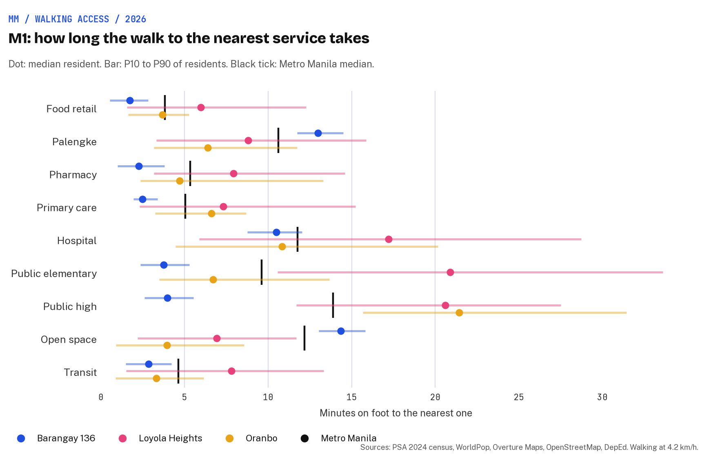
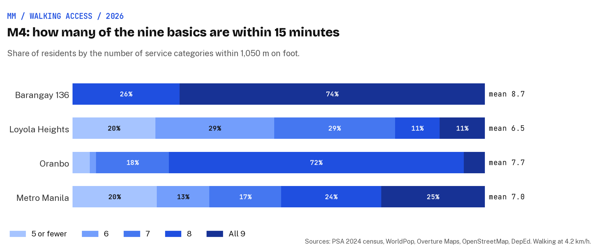
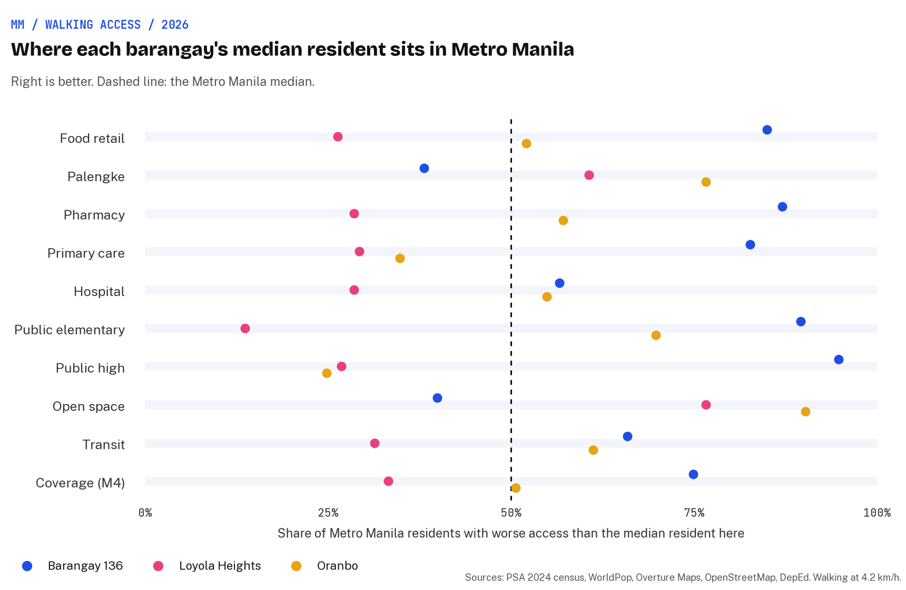
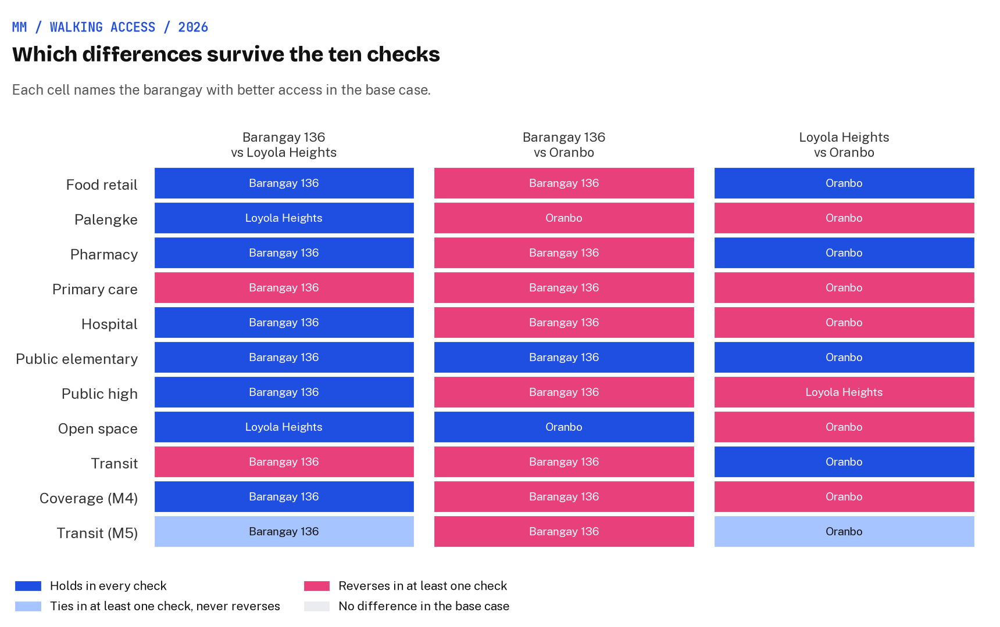

# Walking to everyday life: access to services in three Metro Manila barangays

Earl Yu, November 2026.
Open data only.

This is the full paper for the project.
The research design is final (approved on 4 November 2026), the data are collected and built (section 5) and the results are in (section 6), and a comparison site lets any reader set three barangays of their own side by side ([https://earlcyu-petcircle.github.io/ph-urban-accessibility/](https://earlcyu-petcircle.github.io/ph-urban-accessibility/), section 4.7).

**In short.**
Which of the three Metro Manila barangays I have lived in puts everyday life within a short walk?
The study compares walking access to nine everyday services for every resident of Barangay 136 in Tondo, Loyola Heights in Quezon City and Oranbo in Pasig, and sets each against the rest of Metro Manila.
Five measures, from walking time to the nearest service to supply per resident once crowding is counted, are reported side by side rather than folded into one score.
A difference between the three counts as a finding only if it survives ten changes of assumption.
No barangay wins outright: Barangay 136 has the most of the nine basics within 15 minutes (8.7 on average) but the least supply per resident once crowding is counted; Oranbo has more supply per resident than Metro Manila for most services and the nearest open space, but no public high school within reach; Loyola Heights trails on most basics, above all public schools, and only 48% of its residents have convenient public transport.
14 of the 33 pairwise differences survive all ten checks.
The same measures exist for every Metro Manila barangay, and the comparison site lets a reader pick any three; the three here are one personal point of view, loaded first.
One caveat is already known: sari-sari stores, the corner shops of everyday Filipino life, are almost absent from open maps, so food access will be understated, most of all in Barangay 136.

## Contents

1. [Background](#1-background)
2. [Research questions](#2-research-questions)
3. [Data sources](#3-data-sources)
4. [Research design](#4-research-design)
5. [Data](#5-data)
6. [Results](#6-results)
7. [Discussion](#7-discussion)
8. [Limitations](#8-limitations)
9. [Conclusion and future work](#9-conclusion-and-future-work)
10. [How to reproduce](#10-how-to-reproduce)
11. [References](#references)
12. [Appendix A. Code and pipeline](#appendix-a-code-and-pipeline)
13. [Appendix B. Every figure and table](#appendix-b-every-figure-and-table)
14. [Appendix C. Project history](#appendix-c-project-history)

## 1. Background

I was born and raised in Barangay 136 in Tondo, Manila, spent two years of college in Loyola Heights in Quezon City near Ateneo de Manila, and now live in Oranbo, Pasig.
The three are very different pieces of Metro Manila: a crowded inner-city block, a university barangay of campus, commercial strip and quiet villages, and a small barangay built around a newer mixed-use district.
This project asks how well each serves its residents on foot.

The idea behind it is the 15-minute city: that daily needs such as food, health care, schooling and open space should sit within a short walk or ride of home [1].
Accessibility research gives it a precise meaning: the ease with which people can reach places and opportunities, given where they live, where services are and how they travel [2, 3].
Walking matters more in Metro Manila than the city's traffic suggests: in the 2015 Metro Manila household travel survey, 30.7% of all trips were made on foot [4].

### What earlier studies found

Accessibility research has settled on a small family of measures that trade simplicity against realism [2, 5].

| Family | What it answers | Strength | Weakness | Used here |
|---|---|---|---|---|
| Proximity (time to nearest) | How far is the closest one? | Readable; the basis of 15-minute indices [6, 7, 8] | Ignores choice and crowding | M1 |
| Cumulative opportunities | How many within T minutes? | Simple and transparent [2] | Hard cut-off; results depend on T [5] | M2 |
| Gravity or potential [9] | Opportunities weighted by distance decay | Smooth and theory-backed | Decay needs local calibration; hard to explain | Inside M3 |
| Floating catchment (2SFCA, E2SFCA) | Supply per person within reach, counting competition | Captures crowding; standard for health access [10, 11, 12] | Needs supply capacity; sensitive to catchment size | M3 |
| 15-minute or x-minute index | Share of everyday functions within T | Policy-legible, with Philippine precedent [13, 14] | Any weighting of functions is a value judgement | M4 |
| Walkability index [15, 16] | How good is the walk itself? | Captures quality, not just distance | Needs sidewalk and crossing data Metro Manila lacks | Walk audit |
| Person-based, space-time [17] | What a specific person can reach given their day | Most realistic | Needs travel diaries | Out of scope |
| Transit coverage (SDG 11.2.1) | Share within 500 m of a bus or 1 km of rail | Global standard; allows routes as access points for informal transport [18] | Ignores frequency where timetables are missing | M5 |

Five choices change the answer, and the design fixes each of them on the evidence:

- **Network, not straight line.**
  Straight-line and network distances correlate above 0.95 in Montréal but diverge in suburbs and around barriers [19], and network buffers found land-use effects that circles missed [20].
  Rivers, rail lines, flyovers and gated villages make Metro Manila a barrier-rich case, so every distance here runs on the street network.
- **Fine origins.**
  Representing an area by one centroid misstates access most for common, very local services [21, 19], so origins are buildings, not barangay centroids.
- **The neighbourhood definition is itself a choice.**
  The area that shapes a person's life rarely matches an administrative unit, the uncertain geographic context problem [22], so the barangay result is checked against equal walk-sheds.
- **The measure can change the equity verdict.**
  Different access measures gave different pictures of who is underserved in Tulsa's playgrounds [23], so several measures are reported side by side.
- **Fairness needs a stated principle.**
  Equity work contrasts equal access for everyone with everyone above a minimum [24, 25], so this study reports both the spread inside each barangay and the share above a local minimum.

Open place data is usable but uneven: Overture's UK places matched a supermarket benchmark well, but records from some contributing sources were often incomplete [26].

Philippine and Southeast Asian work gives the design local precedent:

| Study | What it did | What this study borrows |
|---|---|---|
| Pasig 15-minute City Index [13] | Hexagon grid; OpenStreetMap plus Google Maps services for Moreno's six social functions; age-specific walking speeds; road walkability as impedance; 90% of Pasig's barangays scored 0.5 or more | Hexagon reporting, Moreno's functions, the speed sensitivity |
| Quezon City 15-minute City Index [14] | The same index from isochrones; 39% of barangays reached a perfect score, with a south-north divide | A citywide benchmark for Loyola Heights |
| Walking in Metro Manila [4] | From the 2015 household survey: the 75th and 85th percentile walks are 680 m and 872.5 m, and the observed pace is 70.62 m/min | The walking speed and the 10-minute minimum |
| Jeepneys and SDG 11.2.1 [27] | Counting paratransit lifts Metro Manila's share with convenient public transport from 23.9% to 65.0% | Jeepney routes count as transit access |
| Pasig transit and walkability [28] | Public transport coverage and street-level walkability for Pasig's 30 barangays; poorer, more crowded barangays scored worse | The walk audit protocol |
| Healthcare access in the Philippines [12] | E2SFCA for outpatient and inpatient care across municipalities | E2SFCA for health |
| The 15-minute city across Metro Manila [29] | The model across informal settlements, inner-city districts and outer suburbs, with a survey of 420 residents | Reading results against urban type |
| Walkability in Asian cities [16] | Field walkability surveys across 13 Asian cities | Why the quality of the walk matters |

I found no peer-reviewed study comparing specific Metro Manila neighbourhoods on an equal footing; the closest are the Pasig and Quezon City indices at barangay level.

## 2. Research questions

1. **RQ1 Proximity.** How long is the walk from home to the nearest food shop, palengke, pharmacy, clinic, hospital, public school, open space and transit, for the residents of each barangay?
2. **RQ2 Choice.** How many of each are within 5, 10 and 15 minutes?
3. **RQ3 Crowding.** Once the neighbours competing for the same clinic or school are counted, how much service is there per resident?
   A dense barangay can have a clinic round the corner and still be short of care.
4. **RQ4 Transit.** What share of residents is within 500 m of a bus or jeepney and 1 km of rail, the UN's test of convenient public transport?
5. **RQ5 Context and fairness.** Where does each barangay sit among all Metro Manila residents, and how unequal is access inside each?

Where people actually go, and whether access shapes health or income, are out of scope; the study measures potential access and is descriptive, not causal.

## 3. Data sources

Every source is public and free to download.
The PSA census workbook refuses scripted downloads, so it is saved by hand into `data/manual/`; HDX sometimes challenges scripts too, and the [data-quality notes](data-quality.md#getting-the-hand-downloads) give the fallback for each file.

| Role | Source | Grain | Year | Licence | Why this one |
|---|---|---|---|---|---|
| Population count | PSA 2024 Census of Population, by barangay (downloaded by hand) | Barangay | 1 Jul 2024 | PSA publication | Official counts at the smallest administrative unit |
| Population pattern | [WorldPop](https://data.humdata.org/dataset/worldpop-population-counts-2015-2030-phl) R2025A, constrained, 100 m | Pixel | 2024 | CC BY 4.0 | Spreads each barangay's count to where its people live inside it |
| Residential buildings | [Overture Maps](https://docs.overturemaps.org/) buildings | Footprint | Release 2026-10-21.0 | ODbL | Places people within each 100 m cell; Barangay 136 is only about 2.9 ha |
| Population check | JRC GHS-POP R2023A | 100 m cell | 2025 epoch | CC BY 4.0 | A second population surface for the sensitivity check |
| Boundaries and codes | [OCHA COD-AB Philippines](https://data.humdata.org/dataset/cod-ab-phl), PSGC codes | Barangay | Files of 28 May 2026 | CC BY-IGO | Official NAMRIA and PSA boundaries |
| Services | Overture Maps places | Point | Release 2026-10-21.0 | CDLA Permissive 2.0 and per-source terms | The widest open list of shops, clinics and schools, with a confidence score |
| Services, markets, parks, network, transit | [OpenStreetMap](https://download.geofabrik.de/asia/philippines.html), Geofabrik Philippines extract | Point, polygon, way | Pinned snapshot | ODbL | Palengke, parks, the walking network, and jeepney, bus and rail routes |
| Health registry | DOH National Health Facility Registry | Facility | Live | Government publication | Not used: its export fails, even in a browser, so health rests on Overture and OpenStreetMap, with no registry match and no hospital beds |
| Health check | [Healthsites.io](https://data.humdata.org/dataset/philippines-healthsites) | Facility | Sep 2026 | ODbL | An open completeness check on the health layer, used when HDX allows the download (it refused in this build) |
| School registry | DepEd's public-school list as cleaned by OpenStreetMap Philippines ([OSMaPaaralan](https://github.com/OSMPH/deped_schools_db)); [HOT OpenStreetMap education facilities](https://data.humdata.org/dataset/hotosm_phl_education_facilities) | School | 2019; Oct 2026 | DepEd data published for OpenStreetMap use; ODbL | Public schools for the learning categories, with level and enrolment, and their match rate |
| Walk audit | Mapillary street imagery | Photo | Varies | CC BY-SA | Sidewalks, crossings, shade, obstruction and sari-sari stores on sample routes |
| Context, map only | Meta Relative Wealth Index; UP NOAH flood hazard | 2.4 km tile; hazard zone | 2021; varies | CC BY-NC 4.0; to confirm | Planned as optional map context; left out of the comparison site, which keeps to the measures |

What was considered and not used:

- **Timetabled public transport.** The only public Metro Manila feed (Sakay and DOTC GTFS) was last updated in March 2015, before the jeepney route rationalisation, so transit is measured as walking access to stops and routes instead.
- **Google Places.** Its terms forbid storing places, and Overture plus OpenStreetMap cover the same ground openly.
- **OpenStreetMap sidewalk tags as a walking impedance.** Too patchy: around each place, only 1,291 of 5,359 ways near Tondo, 154 of 1,794 near Loyola Heights and 172 of 868 near Oranbo carry any sidewalk tag (Overpass, 4 November 2026). The walk audit covers walk quality instead.
- **The Relative Wealth Index as a measure.** Its 2.4 km tiles are coarser than all three barangays, so it was planned as map context only, and in the end left out.
- **OpenStreetMap history to measure the past.** Mapping completeness has changed more than the places have, so a historical comparison would mostly measure the map's growth.
- **The whole Tondo district as the Tondo unit.** It holds 259 barangays and about 638,000 people, which is not like for like with two single barangays (appendix C).

## 4. Research design

### 4.1 Study areas and unit of analysis

All three places are compared at the same tier, the barangay.

| Barangay | City | PSGC code | People (2024) | Area | People per km² |
|---|---|---|---:|---:|---:|
| Barangay 136 (Tondo) | City of Manila | PH1303901136 | 1,302 | 0.029 km² | 45,400 |
| Loyola Heights | Quezon City | PH1307404055 | 21,768 | 2.43 km² | 9,000 |
| Oranbo | City of Pasig | PH1307403013 | 3,374 | 0.52 km² | 6,500 |

*People from the PSA 2024 Census of Population; areas from the COD-AB boundaries.*

Barangay 136 is about one city block, Loyola Heights is 84 times its area, and Barangay 136 is seven times as dense as Oranbo.
Because the barangays differ so much in size, the comparison is kept about residents, not land:

| Lens | What it is | Why |
|---|---|---|
| Barangay (primary) | Every resident of the three barangays, placed at building level | One administrative tier for all three |
| Services anywhere | Walks may leave the barangay; services in neighbouring barangays and cities count | Stops a one-block barangay being penalised for its boundary [21] |
| Equal walk-shed (check) | The area within a 15-minute walk along streets of each barangay's population-weighted centre | Separates the place from the size of its barangay [20, 22] |
| Home walk-shed (private) | A 15-minute walk from each of my three homes | A front-door check, kept in the gitignored `data/manual/homes.csv` and never published |
| Neighbours | Barangay 136 against the other 258 Tondo barangays; Loyola Heights and Oranbo against their cities | Is each place typical of its area? |
| Metro | All Metro Manila residents | Percentile context |

The unit of analysis is the resident.
People are placed at building level and reported on H3 resolution-10 hexagons (about 0.015 km² each), fine enough for five-minute thresholds and coarse enough that no single home is shown.

Risks specific to these barangays:

- **Barangay 136 is about one block.** Around 1,300 people on 2.9 ha means a narrow spread of results, and a few misplaced buildings could move it, so its footprints get a by-hand check.
- **Loyola Heights is large and mixed.** The Katipunan strip, the Ateneo campus and quieter villages sit in one barangay, so its spread from P10 to P90 and its map matter more than its median.
- **Oranbo is built around Capitol Commons.** In the pilot nobody there was within ten minutes of a palengke, so the service basket matters as much as the distance.

### 4.2 Measures

| ID | Measure | Definition | Threshold | Why |
|---|---|---|---|---|
| M1 | Nearest walk | Minutes from home to the nearest service of each category; reported for the median, P10 and P90 resident | None | The core of proximity-time indices [6] |
| M2 | Choice | Count of each category within T minutes | 5, 10, 15 min | The standard cumulative measure [2] |
| M3 | Crowding-adjusted supply | E2SFCA: supply per 10,000 residents within reach, with Gaussian distance decay inside a 15-minute catchment; supply is 1 per facility, or beds and enrolment where registries give them | 15 min | One nearby clinic serves far more people in a dense barangay [11] |
| M4 | 15-minute coverage | Share of the nine categories with at least one within 15 minutes, unweighted | 15 min | The x-minute-city convention [7, 13]; unweighted because weights are a value judgement [5] |
| M5 | Transit access | Resident within 500 m by street of a bus or jeepney stop or route, and within 1 km of an LRT or MRT station | 500 m; 1 km | UN SDG 11.2.1 [18], with jeepneys reached anywhere on their route [27] |

The headline is the profile of M1 to M5, led by M4 coverage ("eight of nine basics within 15 minutes"), not one weighted composite score.

### 4.3 Service basket and parameters

| Function | Categories |
|---|---|
| Supplying | Food retail (supermarket, grocery, convenience); palengke; pharmacy |
| Caring | Primary care (barangay health station, health centre, clinic); hospital |
| Learning | Public elementary school; public high school |
| Enjoying | Open space of at least 0.1 ha (park, plaza, playground) |
| Moving | Transit: jeepney or bus route or stop; LRT or MRT station |

*Grouped by Moreno's social functions [1]; working and civic functions are left out for want of open jobs data.*

| Parameter | Value |
|---|---|
| Walking speed | 4.2 km/h (70 m/min), close to the observed Metro Manila pace of 70.62 m/min [4] |
| 5 / 10 / 15 / 20 minutes | 350 / 700 / 1,050 / 1,400 m |
| Sufficiency minimum | 10 minutes (700 m), close to the 680 m that three in four Metro Manila walking trips stay within [4] |
| Transit | 500 m to a bus or jeepney, 1 km to rail [18] |
| Fringe beyond Metro Manila | 2 km |
| Origins and display | Residential buildings; H3 resolution 10 |

Every parameter lives in [`src/shared/common.py`](../src/shared/common.py).

### 4.4 Comparing the three barangays fairly

- **Same yardstick.** One data vintage, one service taxonomy, one network rule set, one speed and the same thresholds for all three.
- **One tier, residents as the unit.** All three are barangays, every resident is an origin and services count wherever they are, so barangay size alone does not decide the result; the equal walk-sheds test that.
- **People, not land.** Every statistic is weighted by residents, never by area or by hexagon.
- **Distributions, not just averages.** Median, P10 and P90 resident; the share above the 10-minute minimum; and the P90/P10 ratio inside each barangay [24].
- **Context.** Each barangay's median resident as a percentile of all Metro Manila residents, and of residents in places of similar density, because density drives proximity [6].
- **Robustness over significance.** Every resident is an origin, so there is no sampling error to test; a difference between barangays counts as a finding only if their ordering survives the checks below.

### 4.5 Sensitivity checks

| # | Check | Values | Why |
|---|---|---|---|
| 01 | Walking speed | 3.6, 4.2, 4.8 km/h | Older adults and children walk slower [30, 13] |
| 02 | Time threshold | 5, 10, 15, 20 min | Cut-offs drive cumulative measures [5] |
| 03 | Study area | Barangay against walk-sheds of 10, 15 and 20 min around its population centre | The uncertain geographic context problem [22] |
| 04 | Home lens | 15-minute walk-shed from each home, kept private | Does the front door match the barangay? |
| 05 | Distance type | Street network against straight line | They diverge around barriers [19, 20] |
| 06 | Origin resolution | Building against 100 m cell against H3 resolution 9 | Aggregation error [21] |
| 07 | Service source | Overture only, OpenStreetMap only, merged | Source completeness differs [26] |
| 08 | Overture confidence | 0.3, 0.5, 0.7 | Stale and duplicate listings |
| 09 | Population surface | WorldPop against GHS-POP | Placement error near ports and campuses |
| 10 | Jeepney rule | Routes count against mapped stops only | Informal transit [18] |

### 4.6 Validation and audits

- **Service audit.** A random 30 services per barangay checked against street imagery, giving a found-and-open rate per category.
- **Registry match.** The share of DepEd public schools found in the merged service layer, per area (the DOH registry cannot be exported, so health has no registry match).
- **Walk audit.** About 20 routes in and around each barangay scored on street imagery for sidewalk, crossings, shade and obstruction, after the Pasig protocol [28], with a count of sari-sari stores seen per kilometre; reported beside M1 to M5, not inside them.

### 4.7 The comparison site

The study's three barangays are one point of view, and a reader will want to compare places of their own, so the site lets anyone compare any three.
It is a static site on GitHub Pages ([https://earlcyu-petcircle.github.io/ph-urban-accessibility/](https://earlcyu-petcircle.github.io/ph-urban-accessibility/)) in the style of the [PH lottery story site](https://earlcyu-petcircle.github.io/ph-lottery-outlets/): a one-page story with the comparison embedded near the top, plus a standalone full-screen version.

- **Pick up to three barangays.** Search by name or city, or click the map; the three barangays I have lived in are the featured preset, loaded first and restored with one button.
- **Side by side.** For each pick and for Metro Manila: the 15-minute score (M4 as 0-100: the share of the nine services within 15 minutes, averaged over residents) and its rank among the 1,709 barangays with people; the median resident's minutes to each service (M1); the share within 10 minutes; the transit shares (M5); and supply per resident against the Metro Manila mean (M3).
- **The map.** Barangays or H3 resolution-10 hexagons coloured by the 15-minute score or by minutes to any one service, on fixed classes shared by every service; the services themselves; LRT and MRT lines, and bus and jeepney routes; barangay and city outlines; and the featured barangays' 10, 15 and 20-minute walk-sheds.
- **Data-driven.** The page reads the per-barangay results and the featured preset from files the pipeline writes (`docs/map/data/`), so a new area or a new featured set needs new data, not new code.
- **What it does not carry.** The sensitivity checks of section 4.5 cover only the three featured barangays, so the page says that small gaps between other picks may not hold; M2 counts and the walking-speed and threshold variants stay in the paper and notebooks.
- **Build.** MapLibre GL JS 5.6.0, PMTiles 4.3.0, the OpenFreeMap Positron basemap and tiles built with tippecanoe, served from `docs/`.
- **Privacy.** Only barangays and hexagons are shown; hexagons with fewer than five buildings are left off, and no home location is stored or shown.

### 4.8 What the design can and cannot say

- It measures potential access, not where people actually go or how they choose [17].
- The three barangays are personal cases, so findings describe them, not Metro Manila in general beyond the context layer.
- It sees how far services are and, for health and schools, roughly how crowded, but not their quality or price.
- It describes differences; it does not explain their causes.

## 5. Data

Three inputs hold everything the measures need, built by `./02_build_tables.sh` from the downloads (the large files sit in the gitignored `data/work/`):

- **People:** 1,573,122 residential buildings, each carrying its share of its barangay's 2024 census count, spread by WorldPop and, for check 09, by GHS-POP.
- **Services:** every Overture, OpenStreetMap and DepEd record in the nine categories within 2 km of Metro Manila, with duplicates grouped and a default layer marked; plus the access points round each open space and the vertices of every bus and jeepney route.
- **The walking network:** 16,741 km of walkable OpenStreetMap ways (snapshot of 3 November 2026), 97.3% of nodes in one connected piece.

The small tables are committed:

- [`data/derived/barangays.csv`](../data/derived/barangays.csv): one row per Metro Manila barangay (1,712), with people, area, density, the study and Tondo flags, and building counts.
- [`data/derived/service_quality.csv`](../data/derived/service_quality.csv): service counts by source, and registry match rates, for Metro Manila, the three study cities and the three barangays.
- [`data/derived/data_quality.json`](../data/derived/data_quality.json) and [`census_2024_check.json`](../data/derived/census_2024_check.json): every count and check below.
- [`docs/data-quality.md`](data-quality.md): how each source was parsed and joined, the column dictionary, and where the gaps sit.

The data-quality headline:

- The 2024 census workbook sums to the official 14,001,751 for Metro Manila, and every person lands on a COD-AB barangay; all three study barangays match by name, with 1,302, 21,768 and 3,374 people.
- 99.1% of WorldPop's Metro Manila population sits in a 100 m cell with a residential footprint, so people are placed by buildings and WorldPop together in every barangay.
- In Metro Manila the default layer holds 7,666 food shops, 505 markets, 3,210 pharmacies, 3,582 primary care places, 563 hospitals, 483 public elementary and 231 public high schools, 666 open spaces and 4,201 transit stops and stations.
- 82% of the DepEd public elementary schools and 86% of the public high schools in Metro Manila are found in OpenStreetMap or Overture.
- The known gaps: 234 sari-sari stores mapped in all of Metro Manila and none in Barangay 136; 95 mapped jeepney routes against 768 bus routes; hospitals and primary care without a registry check or bed counts, because the DOH registry cannot be exported; and 112 barangays, none of them study barangays, whose census count is more than three times WorldPop's, mostly where COD-AB and the census draw the boundary differently.

## 6. Results

The analysis runs as six notebooks in [`notebooks/`](../notebooks/), each with its tables, charts and a short reading; this section gives the results they share.
Every figure is weighted by residents: the 14,001,751 people of the 2024 census, placed in 1,573,122 residential buildings.
Walks run along the street network at 4.2 km/h (70 m a minute); services count wherever they are, up to 2 km beyond Metro Manila.
Health services rest on Overture and OpenStreetMap alone, because the DOH facility registry cannot be exported (section 8).

### 6.1 RQ1 Proximity

| Median walk, minutes (M1) | Barangay 136 | Loyola Heights | Oranbo | Metro Manila |
|---|---:|---:|---:|---:|
| Food retail | 1.7 | 6.0 | 3.7 | 3.8 |
| Palengke | 13.0 | 8.8 | 6.4 | 10.6 |
| Pharmacy | 2.3 | 7.9 | 4.7 | 5.4 |
| Primary care | 2.5 | 7.3 | 6.6 | 5.0 |
| Hospital | 10.5 | 17.2 | 10.8 | 11.8 |
| Public elementary | 3.7 | 20.9 | 6.7 | 9.6 |
| Public high | 4.0 | 20.6 | 21.4 | 13.9 |
| Open space | 14.4 | 6.9 | 3.9 | 12.2 |
| Transit | 2.9 | 7.8 | 3.3 | 4.6 |

*The median resident's walk to the nearest service of each category. Food retail is supermarkets, groceries, convenience stores and the few mapped sari-sari stores. Source: [`measures.csv`](../results/tables/measures.csv), with P10, P90 and the share within 10 minutes; figure: [`m1_nearest_walk.png`](../results/figures/m1_nearest_walk.png).*



- **Barangay 136** has the shortest median walk of the three for seven categories, and everyone there is within 10 minutes of food, a pharmacy, primary care, both public school levels and transit.
  Its gaps are the palengke and open space: 2% of residents are within 10 minutes of a palengke, and none of open space.
- **Loyola Heights** has the longest median walk of the three for six categories, and is slower than the Metro Manila median for all but the palengke and open space.
  Its median resident walks about 21 minutes to a public school of either level, and 9% of residents are within 10 minutes of a public elementary school.
- **Oranbo** has the shortest walk to open space (3.9 minutes) and the palengke (6.4), but nobody there is within 10 minutes of a public high school (median 21.4 minutes).
- **Food without convenience stores.** Leaving convenience stores out nearly doubles Oranbo's median walk to food (3.7 to 6.8 minutes), lifts Loyola Heights' from 6.0 to 7.1 and Metro Manila's from 3.8 to 5.8, and barely moves Barangay 136's (1.7 to 1.8).
  Neither version counts the unmapped sari-sari stores.

### 6.2 RQ2 Choice

| Services within 10 minutes, median resident (M2) | Barangay 136 | Loyola Heights | Oranbo | Metro Manila |
|---|---:|---:|---:|---:|
| Food retail | 5 | 7 | 11 | 9 |
| Palengke | 0 | 1 | 1 | 0 |
| Pharmacy | 6 | 2 | 6 | 4 |
| Primary care | 6 | 1 | 4 | 4 |
| Hospital | 1 | 0 | 0 | 0 |
| Public elementary | 2 | 0 | 1 | 1 |
| Public high | 1 | 0 | 0 | 0 |
| Open space | 0 | 1 | 2 | 0 |
| Transit stops and stations | 5 | 2 | 6 | 4 |

*Duplicate records of one service count once. The 5 and 15-minute counts are in [`measures.csv`](../results/tables/measures.csv); figure: [`m2_choice.png`](../results/figures/m2_choice.png).*

- Within 5 minutes Barangay 136's median resident has the most choice (three food shops, four pharmacies, four clinics, against at most one in the other two).
- Within 15 minutes Oranbo's median resident reaches the most food shops (31, against 24 in Loyola Heights and 11 in Barangay 136), pharmacies, hospitals, open spaces and transit stops.
- Loyola Heights' median resident has no public school of either level within 15 minutes.

### 6.3 RQ3 Crowding

| Supply per resident against Metro Manila (M3) | Barangay 136 | Loyola Heights | Oranbo |
|---|---:|---:|---:|
| Food retail | 0.33 | 2.70 | 2.23 |
| Palengke | 0.23 | 3.17 | 5.19 |
| Pharmacy | 0.66 | 1.46 | 2.76 |
| Primary care | 0.83 | 1.19 | 1.58 |
| Hospital | 0.41 | 0.65 | 1.48 |
| Public elementary | 2.36 | 0.15 | 1.01 |
| Public high | 2.95 | 0.40 | 0.00 |
| Open space | 0.05 | 7.07 | 3.37 |

*E2SFCA access of the mean resident, as a multiple of the Metro Manila mean (1.00). Supply is 1 per service, except public schools, which weigh their DepEd 2015 enrolment; with no DOH bed counts, hospitals count 1 each, the design's fallback, so the hospital row is facilities per person rather than beds. Demand is every Metro Manila resident within 15 minutes, with Gaussian decay. Transit has no supply and no M3. Figure: [`m3_crowding.png`](../results/figures/m3_crowding.png).*

- **Barangay 136 is close to services but short of them per person.** Its mean resident has a third of Metro Manila's food supply per person and less than half of its hospital and palengke supply, although these are a short walk away; public schools are the exception (2.4 and 3.0 times Metro Manila).
- **Oranbo has more supply per resident than Metro Manila** for food, the palengke, pharmacies, primary care, hospitals and open space, the Metro Manila level for public elementary places, and almost no public high school places within reach.
- **Loyola Heights** is above Metro Manila for food, the palengke, pharmacies, primary care and open space (7.1 times), and below it for hospitals (0.65) and public schools (0.15 and 0.40).

### 6.4 RQ4 Transit and the 15-minute headline

| | Barangay 136 | Loyola Heights | Oranbo | Metro Manila |
|---|---:|---:|---:|---:|
| **M4** categories within 15 minutes, mean (of 9) | 8.7 | 6.5 | 7.7 | 7.0 |
| M4 share of residents with all nine | 74% | 11% | 5% | 25% |
| **M5** within 500 m of a bus or jeepney stop or route | 100% | 46% | 95% | 66% |
| M5 within 1 km of an LRT or MRT station | 0% | 26% | 0% | 11% |
| M5 convenient access by either (SDG 11.2.1) | 100% | 48% | 95% | 66% |

*Figures: [`m4_coverage.png`](../results/figures/m4_coverage.png), [`m5_transit.png`](../results/figures/m5_transit.png).*



- **Coverage (M4).** In the headline's own terms, Barangay 136's typical resident has all nine basics within 15 minutes, Oranbo's eight and Loyola Heights' seven, against seven for Metro Manila.
  The usual missing category is open space in Barangay 136 (at the edge of 15 minutes), a public high school in Oranbo, and public schools, and for some a hospital, in Loyola Heights.
- **Transit (M5).** Every resident of Barangay 136 and 95% of Oranbo's have convenient public transport by the UN test, all through buses and jeepneys; neither is within 1 km of rail.
  Loyola Heights is lowest at 48%, with 26% of residents within 1 km of an LRT-2 station.
  Only 95 jeepney routes are mapped in the study area, so these shares are floors: with mapped stops alone (check 10), Oranbo falls to 58% and Loyola Heights to 40%.

### 6.5 RQ5 Context and fairness

| Share of Metro Manila residents with worse access than the median resident | Barangay 136 | Loyola Heights | Oranbo |
|---|---:|---:|---:|
| Food retail | 85% | 26% | 52% |
| Palengke | 38% | 61% | 77% |
| Pharmacy | 87% | 29% | 57% |
| Primary care | 83% | 29% | 35% |
| Hospital | 57% | 29% | 55% |
| Public elementary | 90% | 14% | 70% |
| Public high | 95% | 27% | 25% |
| Open space | 40% | 77% | 90% |
| Transit | 66% | 31% | 61% |
| Coverage (M4) | 75% | 33% | 51% |

*Above 50% is better than the Metro Manila median. [`context.csv`](../results/tables/context.csv) also gives each share among residents of barangays of similar density; figure: [`context_percentiles.png`](../results/figures/context_percentiles.png).*



- **Against Metro Manila,** Barangay 136's and Oranbo's median residents are each in the better-served part of the city for seven of the nine categories, and Loyola Heights' for two (the palengke and open space).
- **Against places of similar density,** Loyola Heights and Oranbo (both in the least dense tenth of Metro Manila's residents) both move up; Oranbo sits above the middle for every category except public high schools (49%), Loyola Heights below it for six.
- **Against the neighbours,** Barangay 136 is quicker than the other 258 Tondo barangays for food, pharmacies, clinics and schools and slower for the palengke, hospitals, open space and transit (coverage 8.7 against 8.0); Loyola Heights is slower than the rest of Quezon City for all but the palengke and open space (6.5 against 6.8); Oranbo is quicker than the rest of Pasig for the palengke, open space, elementary schools and transit and slower for primary care and public high schools (7.7 against 7.5).
- **Inside each barangay,** access is most even in Barangay 136 (P90/P10 ratios of 1.2 to 5.3), as a one-block barangay must be; Loyola Heights is the most unequal of the three for food (7.8) and transit (8.9), and Oranbo for open space (9.5).

### 6.6 Robustness

Of the 33 pairwise differences in the headline metrics (the median walk to each of the nine categories, M4 and M5, for three pairs of barangays), 14 keep their order in every variant of all ten checks, and two more only tie somewhere.



| Finding that survives every check | Base case |
|---|---|
| Loyola Heights has a longer walk than both others to food, pharmacies and public elementary schools | e.g. food 6.0 against 1.7 and 3.7 minutes |
| Loyola Heights has a longer walk than Barangay 136 to hospitals and public high schools, and fewer categories within 15 minutes | coverage 6.5 against 8.7 |
| Loyola Heights has a longer walk than Oranbo to transit | 7.8 against 3.3 minutes |
| Barangay 136 has a shorter walk than both others to public elementary schools | 3.7 against 20.9 and 6.7 minutes |
| Barangay 136 has a longer walk than both others to open space, and than Loyola Heights to the palengke | open space 14.4 against 6.9 and 3.9 minutes |

*[`robustness.csv`](../results/tables/robustness.csv) lists every pair and the variants that change it; [`sensitivity.csv`](../results/tables/sensitivity.csv) every value.*

- **The study-area check decides most of the rest.** The equal walk-shed check (03) changes 14 orderings and reverses 11, most of them between Barangay 136 and Oranbo: a 10 to 20-minute walk-shed round Barangay 136's centre takes in many Tondo blocks around the one-block barangay.
  So most differences between Barangay 136 and Oranbo reflect the barangays' sizes as much as the places.
- **The data choices matter less.** The service source (07) changes seven orderings, straight-line distance (05) five, origin resolution (06) four, and the time threshold (02), Overture confidence (08) and the population surface (09) one each; walking speed (01) and the jeepney rule (10) change none.
- **The home lens (04)** is run privately from home points kept off the repository and was not run for this build.

### 6.7 Audits

- **Registry match.** OpenStreetMap or Overture holds a record for 82% of Metro Manila's DepEd public elementary schools and 86% of its public high schools, and for every DepEd school in Loyola Heights and Oranbo ([`registry_match.csv`](../results/tables/registry_match.csv)).
  There is no registry check for health: the DOH registry cannot be exported, and HDX refused the Healthsites.io download.
- **Service and walk audits.** The fixed samples are drawn: 30 services within 15 minutes of each barangay's residents ([`service_audit_sample.csv`](../results/tables/service_audit_sample.csv)) and 20 walking routes from street points in each barangay ([`walk_audit_routes.csv`](../results/tables/walk_audit_routes.csv)), each with a street-imagery link.
  Scoring the imagery, including the sari-sari stores seen per kilometre, is a by-hand step still to do, so their results are not in this version.

## 7. Discussion

*What the results say about the three featured barangays; the comparison site extends the same measures to any barangay.*

- **No barangay wins outright.** Barangay 136 puts the most of the nine basics within a short walk, but it has the least supply per resident of the three for most services once neighbours are counted, and lacks open space and a palengke nearby; Oranbo has more supply per resident than Metro Manila for most services and the shortest walk to open space, but no public high school within reach; Loyola Heights trails on most basics, most of all public schools, and has the lowest transit share.
- **Proximity and crowding point different ways in the densest place,** as the design expected: Barangay 136's short walks hide less supply per person for food, hospitals and the palengke.
- **Only the differences in section 6.6 are findings.** Many others, above all between Barangay 136 and Oranbo, do not survive the equal walk-shed check.
- **What the results cannot say:** they measure potential access on mapped services, not where people go; food access leaves out sari-sari stores; and health access rests on open data without a registry check.

## 8. Limitations

- **Sari-sari stores are almost unmapped, and this is the study's biggest gap.**
  The corner sari-sari store is part of everyday Filipino life, yet OpenStreetMap names only 256 of them in a box around all of Metro Manila, against 4,983 mapped convenience shops (Overpass, 4 November 2026).
  For scale, one retail-tech firm's partner network alone counts more than 300,000 sari-sari stores nationwide [31]; I found no recent official count.
  So "food retail" here means supermarkets, groceries, convenience stores and the palengke, and the measured walk to everyday food will be too long, most of all in dense streets like Barangay 136's; carinderias are missing in the same way.
  The study states this on every food figure, chart and map legend, counts sari-sari stores on the walk-audit routes to give a stores-per-kilometre figure beside the measures, and reports food access with and without convenience stores so readers can see how much the definition matters.
- **Potential, not realised, access.** There is no data on where people actually go.
- **Mapped is not there.** Beyond informal retail, new shops are missed and closed ones kept, which the service audit measures.
- **No health registry.** The DOH National Health Facility Registry cannot be exported (the export fails even in a browser), so hospitals and primary care rest on Overture and OpenStreetMap alone, with no registry match.
  Hospitals have no bed counts, so the crowding measure (M3) counts each hospital as 1, the design's fallback: it measures hospitals per person, not beds.
  The open cross-check, Healthsites.io, could not be downloaded either (HDX refused it).
- **Quality, price and capacity** of services are invisible except where registries give capacity: school enrolment from DepEd (2015 figures).
- **The edge of the study area.** People just outside Metro Manila are not placed, so services near its edge face less competition in M3 than they do.
- **Hops in M2 and M3.** Counts and crowding are read at each home's nearest street node, without the short hop to it (median 23 m), which M1, M4 and M5 include.
- **The audits are drawn, not yet scored.** The service and walk audit samples wait for by-hand scoring on street imagery, so the found-and-open rates and the sari-sari count per kilometre are still to come.
- **The walk itself.** Heat, floods, crossings, footbridges, safety and sidewalks are not in the network; the walk audit covers only a sample of routes.
- **Jeepney routes may be dated.** OpenStreetMap routes may pre-date the LTFRB route rationalisation, which check 10 brackets.
- **Population can land in the wrong place.** Placement errors cluster at ports, reclamations, campuses and malls, so every building in Barangay 136, the Ateneo campus and Capitol Commons get a by-hand check.
- **The layers come from different years.** The census is from mid-2024; places and the network are from late 2026.

## 9. Conclusion and future work

No barangay of the three puts all of everyday life within a short walk: the densest has nearly everything close but shares it among the most people, the newest district has room but no public high school nearby, and the university barangay trails on most basics.
The same measures now cover every Metro Manila barangay, so readers can set their own places against these three.

What would take this further, already visible from the design:

- **Map the sari-sari stores** on the audit routes into OpenStreetMap, so the gap narrows for everyone.
- **Walk the routes in person** to check the street-imagery audit.
- **Add timetabled transit** if a current public Metro Manila GTFS feed appears.
- **Add access to jobs** if open employment locations become available.

## 10. How to reproduce

All four phases run.

```bash
git clone https://github.com/earlcyu-petcircle/ph-urban-accessibility.git
cd ph-urban-accessibility
./run_all.sh              # every phase below, in order
./run_all.sh --refresh    # same, but pull fresh OpenStreetMap and Overture snapshots

./01_collect_data.sh      # downloads into data/raw/
./02_build_tables.sh      # people, services and the walking network
./03_analyse.sh           # the five measures, checks and audits in results/
./04_build_map.sh         # comparison site data in docs/map/data/
python3 src/04_build_map/serve_map.py   # the site at http://localhost:8000/
```

It needs Python 3.12, `curl` and [tippecanoe](https://github.com/felt/tippecanoe) (`brew install tippecanoe`); nothing else is installed globally, since `src/shared/setup.sh` makes a local virtual environment from `requirements.txt`.
The downloads take about 1.3 GB, the build about two minutes and the analysis about three.
The PSA 2024 census workbook is saved by hand into `data/manual/` as the [data-quality notes](data-quality.md#getting-the-hand-downloads) describe, and the private home points for the home lens go in `data/manual/homes.csv`; the whole folder is gitignored.

## References

Each entry was checked against its Crossref or publisher record on 4 November 2026.
Entries marked (abstract) were read from their abstract or publication page only.

1. Moreno, C., Allam, Z., Chabaud, D., Gall, C. and Pratlong, F. "Introducing the "15-minute city": sustainability, resilience and place identity in future post-pandemic cities." *Smart Cities* 4 (1), 93-111, 2021. <https://doi.org/10.3390/smartcities4010006> (abstract)
2. Geurs, K. T. and van Wee, B. "Accessibility evaluation of land-use and transport strategies: review and research directions." *Journal of Transport Geography* 12 (2), 127-140, 2004. <https://doi.org/10.1016/j.jtrangeo.2003.10.005> (abstract)
3. Pereira, R. H. M. and Herszenhut, D. *Introduction to urban accessibility: a practical guide with R.* Ipea, 2023. <https://doi.org/10.38116/9786556350653> (abstract)
4. Tolentino, N. J. Y. and Sigua, R. G. "Characteristics of walking and cycling in Metro Manila, Philippines." *Philippine Transportation Journal* 5 (1), 2022. <https://ncts.upd.edu.ph/tssp/wp-content/uploads/2022/12/TSSP2022_Vol5-No1_02-Tolentino-and-Sigua.pdf>
5. Páez, A., Scott, D. M. and Morency, C. "Measuring accessibility: positive and normative implementations of various accessibility indicators." *Journal of Transport Geography* 25, 141-153, 2012. <https://doi.org/10.1016/j.jtrangeo.2012.03.016> (abstract)
6. Bruno, M., Monteiro Melo, H. P., Campanelli, B. and Loreto, V. "A universal framework for inclusive 15-minute cities." *Nature Cities* 1, 633-641, 2024. <https://doi.org/10.1038/s44284-024-00119-4>
7. Logan, T. M., Hobbs, M. H., Conrow, L. C., Reid, N. L., Young, R. A. and Anderson, M. J. "The x-minute city: measuring the 10, 15, 20-minute city and an evaluation of its use for sustainable urban design." *Cities* 131, 103924, 2022. <https://doi.org/10.1016/j.cities.2022.103924> (abstract)
8. Nicoletti, L., Sirenko, M. and Verma, T. "Disadvantaged communities have lower access to urban infrastructure." *Environment and Planning B* 50 (3), 831-849, 2023. <https://doi.org/10.1177/23998083221131044> (abstract)
9. Hansen, W. G. "How accessibility shapes land use." *Journal of the American Institute of Planners* 25 (2), 73-76, 1959. <https://doi.org/10.1080/01944365908978307> (abstract)
10. Luo, W. and Wang, F. "Measures of spatial accessibility to health care in a GIS environment: synthesis and a case study in the Chicago region." *Environment and Planning B* 30 (6), 865-884, 2003. <https://doi.org/10.1068/b29120> (abstract)
11. Luo, W. and Qi, Y. "An enhanced two-step floating catchment area (E2SFCA) method for measuring spatial accessibility to primary care physicians." *Health & Place* 15 (4), 1100-1107, 2009. <https://doi.org/10.1016/j.healthplace.2009.06.002> (abstract)
12. Leyso, N. L. and Umezaki, M. "Spatial inequality in the accessibility of healthcare services in the Philippines." *GeoJournal* 89, 120, 2024. <https://doi.org/10.1007/s10708-024-11098-3> (abstract)
13. Mañago, C. A. R., Nasalita, M. G., Saveron, C. V., Sunga, Y. A. D. and Claridades, A. R. C. "Development of a fifteen-minute city index using walkability scores and age-classified population: the case of Pasig City, Metro Manila, Philippines." *ISPRS International Journal of Geo-Information* 14 (2), 78, 2025. <https://doi.org/10.3390/ijgi14020078>
14. Mañago, C. A. R., Nasalita, M. G., Saveron, C. V., Sunga, Y. A. D. and Claridades, A. R. C. "Developing a geospatial framework for calculating a 15-Minute City Index (FMCI): the case of Quezon City." *Proceedings of GISTAM 2025*, 73-84, 2025. <https://doi.org/10.5220/0013426100003935> (abstract)
15. Frank, L. D., Sallis, J. F., Saelens, B. E. et al. "The development of a walkability index: application to the Neighborhood Quality of Life Study." *British Journal of Sports Medicine* 44 (13), 924-933, 2010. <https://doi.org/10.1136/bjsm.2009.058701> (abstract)
16. Leather, J., Fabian, H., Gota, S. and Mejia, A. *Walkability and pedestrian facilities in Asian cities: state and issues.* ADB Sustainable Development Working Paper Series, Asian Development Bank, 2011. <https://www.adb.org/publications/walkability-and-pedestrian-facilities-asian-cities-state-and-issues> (abstract)
17. Kwan, M.-P. "Space-time and integral measures of individual accessibility: a comparative analysis using a point-based framework." *Geographical Analysis* 30 (3), 191-216, 1998. <https://doi.org/10.1111/j.1538-4632.1998.tb00396.x> (abstract)
18. UN Statistics Division and UN-Habitat. *SDG indicator metadata 11.2.1: proportion of population that has convenient access to public transport.* Last updated 23 April 2025. <https://unstats.un.org/sdgs/metadata/files/Metadata-11-02-01.pdf>
19. Apparicio, P., Abdelmajid, M., Riva, M. and Shearmur, R. "Comparing alternative approaches to measuring the geographical accessibility of urban health services: distance types and aggregation-error issues." *International Journal of Health Geographics* 7, 7, 2008. <https://doi.org/10.1186/1476-072X-7-7> (abstract)
20. Oliver, L. N., Schuurman, N. and Hall, A. W. "Comparing circular and network buffers to examine the influence of land use on walking for leisure and errands." *International Journal of Health Geographics* 6, 41, 2007. <https://doi.org/10.1186/1476-072X-6-41> (abstract)
21. Hewko, J., Smoyer-Tomic, K. E. and Hodgson, M. J. "Measuring neighbourhood spatial accessibility to urban amenities: does aggregation error matter?" *Environment and Planning A* 34 (7), 1185-1206, 2002. <https://doi.org/10.1068/a34171> (abstract)
22. Kwan, M.-P. "The uncertain geographic context problem." *Annals of the Association of American Geographers* 102 (5), 958-968, 2012. <https://doi.org/10.1080/00045608.2012.687349> (abstract)
23. Talen, E. and Anselin, L. "Assessing spatial equity: an evaluation of measures of accessibility to public playgrounds." *Environment and Planning A* 30 (4), 595-613, 1998. <https://doi.org/10.1068/a300595> (abstract)
24. Lucas, K., van Wee, B. and Maat, K. "A method to evaluate equitable accessibility: combining ethical theories and accessibility-based approaches." *Transportation* 43 (3), 473-490, 2016. <https://doi.org/10.1007/s11116-015-9585-2> (abstract)
25. Pereira, R. H. M., Schwanen, T. and Banister, D. "Distributive justice and equity in transportation." *Transport Reviews* 37 (2), 170-191, 2017. <https://doi.org/10.1080/01441647.2016.1257660> (abstract)
26. Ballantyne, P. and Berragan, C. "Overture Point of Interest data for the United Kingdom: a comprehensive, queryable open data product, validated against Geolytix supermarket data." *Environment and Planning B* 51 (8), 1974-1980, 2024. <https://doi.org/10.1177/23998083241263124> (abstract)
27. Hasselwander, M., Nieland, S., Dematera-Contreras, K. and Goletz, M. "MaaS for the masses: potential transit accessibility gains and required policies under Mobility-as-a-Service." *Multimodal Transportation* 2 (3), 100086, 2023. <https://doi.org/10.1016/j.multra.2023.100086> (abstract)
28. Nogueira, A. C. C. S. and Diaz, C. E. D. "Evaluating public transport accessibility and walkability in Pasig City (Philippines) and their correlation to socioeconomic factors at the barangay level." *Asian Transport Studies* 9, 100117, 2023. <https://doi.org/10.1016/j.eastsj.2023.100117> (abstract)
29. Lamentillo, A. M. Y. "Assessing the viability of the 15-minute city model in Metro Manila." *LSE International Development Review* 4 (1), 155-189, 2025. <https://idr.lse.ac.uk/articles/110> (abstract)
30. Bohannon, R. W. "Comfortable and maximum walking speed of adults aged 20-79 years: reference values and determinants." *Age and Ageing* 26 (1), 15-19, 1997. <https://doi.org/10.1093/ageing/26.1.15> (abstract)
31. Interaksyon. "More sari-sari stores selling 'tingi' supplies spring up near schools, says study." 14 August 2025. <https://media.interaksyon.com/trends-spotlights/2025/08/14/300595/more-sari-sari-stores-selling-tingi-supplies-spring-up-near-schools-says-study/> (news; used only for the size of one firm's store network)

Data: PSA 2024 Census of Population; WorldPop, University of Southampton (CC BY 4.0); JRC GHS-POP (CC BY 4.0); OCHA COD-AB Philippines (CC BY-IGO); © OpenStreetMap contributors (ODbL); Overture Maps buildings (ODbL) and places (CDLA Permissive 2.0 and per-source terms); DepEd, via OpenStreetMap Philippines' OSMaPaaralan; HOT (ODbL); Mapillary (CC BY-SA).

## Appendix A. Code and pipeline

The code sits in one folder per phase under [`src/`](../src/), named after the phase script at the repo root that runs it, with shared paths and study constants in [`src/shared/common.py`](../src/shared/common.py) and the phase scripts' setup in [`src/shared/setup.sh`](../src/shared/setup.sh).
All four phases are built.
The analysis runs as six narrative notebooks in [`notebooks/`](../notebooks/), committed with their outputs so each table and chart sits beside a short reading; their logic lives in [`src/03_analyse/`](../src/03_analyse/), which they import.
Shared helpers are in [`src/shared/`](../src/shared/): `common.py` (paths and study constants), `service_rules.py` (the rules that sort places into categories), `atlas.py` (the Atlas Grid chart style and its Riso data palette, mirrored from ph-lottery-outlets, with the fonts committed in `fonts/`), `run_notebook.py` (the notebook runner) and `setup.sh` (the phase scripts' setup).
Libraries are added to `requirements.txt` in the PR that first uses them.

| Phase script | Step | Script | Writes | PR |
|---|---|---|---|---|
| `01_collect_data.sh` | Download the open sources | `src/01_collect_data/download_sources.sh` | `data/raw/` (gitignored) | 2 |
| | Overture places and buildings | `src/01_collect_data/download_overture.py` | `data/raw/` | 2 |
| `02_build_tables.sh` | Read the 2024 census workbook and join it to COD-AB | `src/02_build_tables/read_census_2024.py` | `data/work/census_2024.parquet`, `data/derived/census_2024_check.json` | 2 |
| | Place people in buildings | `src/02_build_tables/place_people.py` | `data/work/origins.parquet` | 2 |
| | The nine-category service layer and registry match | `src/02_build_tables/build_services.py` | `data/work/services.parquet`, `open_space_access.parquet`, `transit_routes.parquet`, `data/derived/service_quality.csv` | 2 |
| | The walking network | `src/02_build_tables/build_walk_network.py` | `data/work/walk_nodes.parquet`, `walk_edges.parquet` | 2 |
| | Barangay and data-quality tables | `src/02_build_tables/build_tables.py` | `data/derived/barangays.csv`, `data_quality.json` | 2 |
| `03_analyse.sh` | Walking distances from every resident to every category | `src/03_analyse/walk_times.py` | `data/work/walk_times.parquet`, `nearest_nodes.npz` | 3 |
| | M1 nearest walk and M2 choice (RQ1, RQ2) | [`notebooks/01_proximity_and_choice.ipynb`](../notebooks/01_proximity_and_choice.ipynb), with `measures.py` | `results/tables/measures.csv` | 3 |
| | M3 crowding (RQ3) | [`notebooks/02_crowding.ipynb`](../notebooks/02_crowding.ipynb) | figures | 3 |
| | M4 coverage and M5 transit (RQ4) | [`notebooks/03_coverage_and_transit.ipynb`](../notebooks/03_coverage_and_transit.ipynb) | figures | 3 |
| | Context and fairness (RQ5) | [`notebooks/04_context_and_fairness.ipynb`](../notebooks/04_context_and_fairness.ipynb) | `results/tables/context.csv` | 3 |
| | The ten sensitivity checks | [`notebooks/05_robustness.ipynb`](../notebooks/05_robustness.ipynb), with `sensitivity.py` | `results/tables/sensitivity.csv`, `robustness.csv` | 3 |
| | Registry match and the audit samples | [`notebooks/06_audits.ipynb`](../notebooks/06_audits.ipynb), with `audits.py` | `results/tables/registry_match.csv`, `service_audit_sample.csv`, `walk_audit_routes.csv` | 3 |
| | Figures (Atlas style, Riso palette) | `src/03_analyse/charts.py` | `results/figures/` | 3 |
| `04_build_map.sh` | Map tiles, every barangay's measures and the featured preset | `src/04_build_map/build_map_tiles.py` | `docs/map/data/` | 4 |
| | The map's classes and colours, from `src/shared/map_layers.py` | `src/04_build_map/write_web_palette.py` | `docs/map/palette.js` | 4 |
| | Local preview server | `src/04_build_map/serve_map.py` | | 4 |
| | The story page and the comparison map | [`docs/index.html`](index.html), [`docs/map/index.html`](map/index.html) | | 4 |

## Appendix B. Every figure and table

| Figure or table | What it shows | Section |
|---|---|---|
| [`m1_nearest_walk.png`](../results/figures/m1_nearest_walk.png) | Minutes to the nearest service: median, P10 to P90, Metro Manila median | 6.1 |
| [`m2_choice.png`](../results/figures/m2_choice.png) | Services within 10 minutes of the median resident | 6.2 |
| [`m3_crowding.png`](../results/figures/m3_crowding.png) | E2SFCA access against the Metro Manila mean | 6.3 |
| [`m4_coverage.png`](../results/figures/m4_coverage.png) | Categories within 15 minutes, share of residents | 6.4 |
| [`m5_transit.png`](../results/figures/m5_transit.png) | Convenient public transport, SDG 11.2.1 | 6.4 |
| [`context_percentiles.png`](../results/figures/context_percentiles.png) | Each barangay's median resident among Metro Manila's | 6.5 |
| [`robustness.png`](../results/figures/robustness.png) | Which differences survive the ten checks | 6.6 |
| [`measures.csv`](../results/tables/measures.csv) | M1 to M5 for the three barangays, their neighbours and Metro Manila | 6.1 to 6.5 |
| [`context.csv`](../results/tables/context.csv) | Metro Manila and similar-density percentiles | 6.5 |
| [`sensitivity.csv`](../results/tables/sensitivity.csv), [`robustness.csv`](../results/tables/robustness.csv) | Every check's values; every pair's verdict | 6.6 |
| [`registry_match.csv`](../results/tables/registry_match.csv) | DepEd schools found in the open sources | 6.7 |
| [`service_audit_sample.csv`](../results/tables/service_audit_sample.csv), [`walk_audit_routes.csv`](../results/tables/walk_audit_routes.csv) | The audit worksheets, to be scored by hand | 6.7 |

The comparison site is at [https://earlcyu-petcircle.github.io/ph-urban-accessibility/](https://earlcyu-petcircle.github.io/ph-urban-accessibility/); [`docs/map/data/barangay_measures.csv`](map/data/barangay_measures.csv) holds every measure for every barangay with people.

## Appendix C. Project history

The study is built in steps, each a pull request.
A first pass ([#1](https://github.com/earlcyu-petcircle/ph-urban-accessibility/pull/1)), closed unmerged on 4 November 2026, scored all 1,710 Metro Manila barangays and compared the whole Tondo district against two single barangays, with its logic split across SQL files and Python scripts.
The research design was then redone from the literature, reviewed in three rounds and approved on 4 November 2026: barangay level for all three places, a private home lens, walking plus walking to transit, nine service categories, a profile of measures rather than one score, today's data only, and a street-imagery walk audit.
[#2](https://github.com/earlcyu-petcircle/ph-urban-accessibility/pull/2) puts this paper and the project skeleton in place.
[#3](https://github.com/earlcyu-petcircle/ph-urban-accessibility/pull/3) collects the data and builds the analysis inputs (section 5); the 2008 DepEd school file gave way to DepEd's 2019 list as cleaned by OpenStreetMap Philippines, because HDX refused scripted downloads that day and the newer list carries school levels and enrolment.
[#4](https://github.com/earlcyu-petcircle/ph-urban-accessibility/pull/4) runs the analysis (section 6); with it the DOH registry was dropped for good, because its export fails even in a browser.
[#5](https://github.com/earlcyu-petcircle/ph-urban-accessibility/pull/5) builds the story site and turns its map into a comparison of any three barangays, with the three I have lived in as one featured point of view; with it the repository was renamed from metro-manila-accessibility to ph-urban-accessibility, since later series may cover the whole country.
[#6](https://github.com/earlcyu-petcircle/ph-urban-accessibility/pull/6) cleans up: it removes leftovers of the step-by-step build and updates the notes that pointed to later steps.
